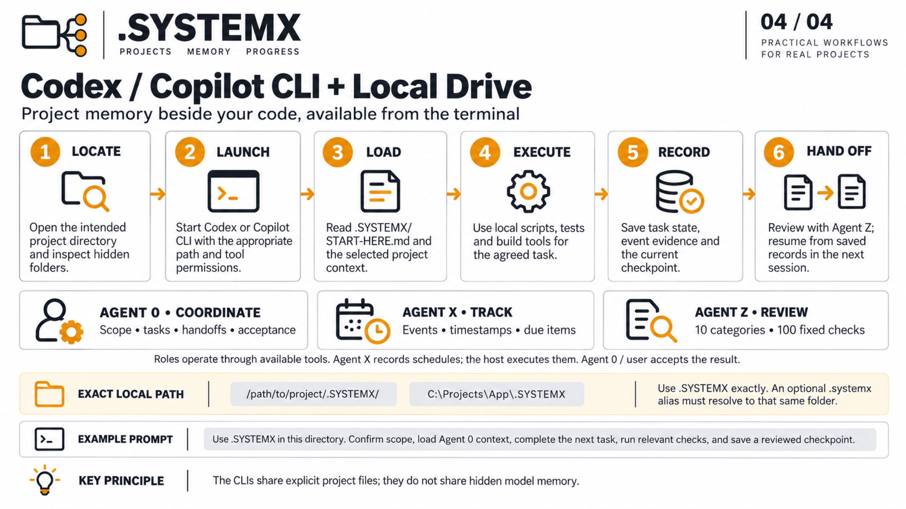

# Codex / Copilot CLI + local drive

[Gallery](../README.md) · [4K JPEG](../Infographics/codex-copilot-cli-local-4k.jpg)

[](../Infographics/codex-copilot-cli-local-4k.jpg)

**Artwork baseline:** the retained card depicts Agent 0/X/Z. See the current
[full-system map](cli-projects.md) for all four roles and the optional Agent Y
CLI lane. This text guide follows the current format.

## Workflow

1. **Locate.** Open the intended project directory and inspect hidden folders.
2. **Launch.** Start Codex or Copilot CLI with the appropriate path and tool permissions.
3. **Load.** Read .SYSTEMX/START-HERE.md and the selected project context.
4. **Execute.** Use local scripts, tests and build tools for the agreed task.
5. **Record.** Save task state, event evidence and the current checkpoint.
6. **Hand Off.** Review with Agent Z; resume from saved records in the next session.

## Agent responsibilities

- **Agent 0:** scope, tasks, handoffs and acceptance within user authority.
- **Agent X:** events, timestamps and due items; the host executes schedules.
- **Agent Y (optional):** carries one Agent 0 task into a selected installed CLI,
  returns a scoped diff and evidence, and may own an authorized task branch/PR.
- **Agent Z:** the fixed review policy with 10 categories and 100 questions.

These are roles implemented through the available toolchain. The public template
starts with Agent 0 only; [activate X/Y/Z](../../docs/AGENT-Y.md#activate-and-inspect) explicitly in
the selected scope. A review score is advisory and does not approve external actions.
The pictured card focuses on Agent 0/X/Z; [Agent Y](../../docs/AGENT-Y.md) is
the optional separate CLI handoff when an app or IDE coordinates the project.

Example locations are `/path/to/project/.SYSTEMX/` and
`C:\Projects\App\.SYSTEMX`. Start either CLI in the intended project; keep
its existing instruction discovery and permissions in force. Use `.SYSTEMX`
exactly. An optional `.systemx` alias must resolve to that same directory.
The two CLIs reuse explicit saved files rather than hidden model memory.
Record what checks actually ran and keep Git/backup synchronization explicit.
Select one CLI provider for each Agent Y task and verify its executable, account,
working tree, allowed paths, and budget. App subagents and the CLI share the same
project worker budget; neither session automatically inherits the other's context.
Draft PR creation is opt-in after a successful run; no CLI process auto-merges.
`prepare` pins the selected executable's absolute path, SHA-256, device, inode,
and size in ignored local state. `run` checks that identity before dispatch;
a provider update requires reviewed re-preparation. Local sidecars and cleanup
bundles must stay ignored and untracked. The worktree and file allowlist do not
isolate the provider from the host account's credentials or other local files.
Native Windows Agent Y `run --apply` is disabled in this alpha because
descendant-process termination is unverified. Core Windows records and setup
remain available; use a reviewed supported host for the delegated CLI lane.

## Copyable prompt

```text
Use .SYSTEMX in this directory. Confirm scope, load Agent 0 context, complete the next task, run relevant checks, and save a reviewed checkpoint.
```

For optional delegation from an app/IDE coordinator:

```text
Use .SYSTEMX Agent 0 to assign [TASK ID] to Agent Y using [INSTALLED CLI].
Confirm the selected root or .SYSTEMXP scope, account, source/base revision,
allowed paths, project checks, and shared worker/time/cost budget. Preview the
handoff before applying it. Open a draft PR only if this task opts in. Return
the job and commit/diff metadata, preserve the worktree, and obtain original
check evidence for review. Agent X records observed events; Agent Z reviews
the matching evidence. Acceptance, PR readiness, merge, and cleanup are
separate reviewed steps. Stop on a concrete blocker or uncertain remote state.
```

## Platform reference

Copilot CLI exposes directory trust and tool/path permissions; configure them for the intended project. See [Copilot CLI configuration](https://docs.github.com/en/copilot/how-tos/copilot-cli/set-up-copilot-cli/configure-copilot-cli). Codex also supports selecting a working directory; check your installed CLI help and [Codex CLI documentation](https://learn.chatgpt.com/docs/codex/cli).

Platform references checked 2026-10-04. Availability and permissions depend on
the account, host and configuration. The workflow is a .SYSTEMX usage pattern,
not a built-in integration or third-party endorsement.
