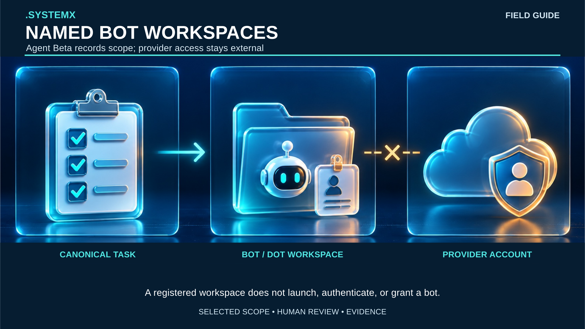
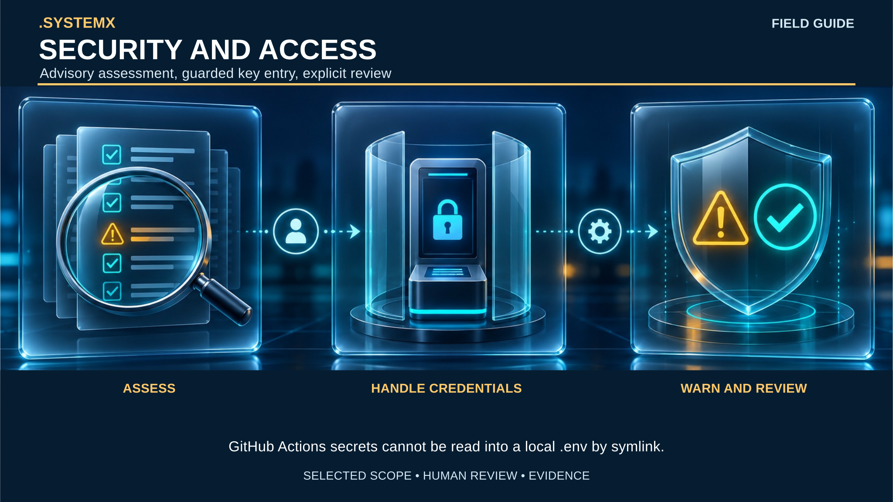
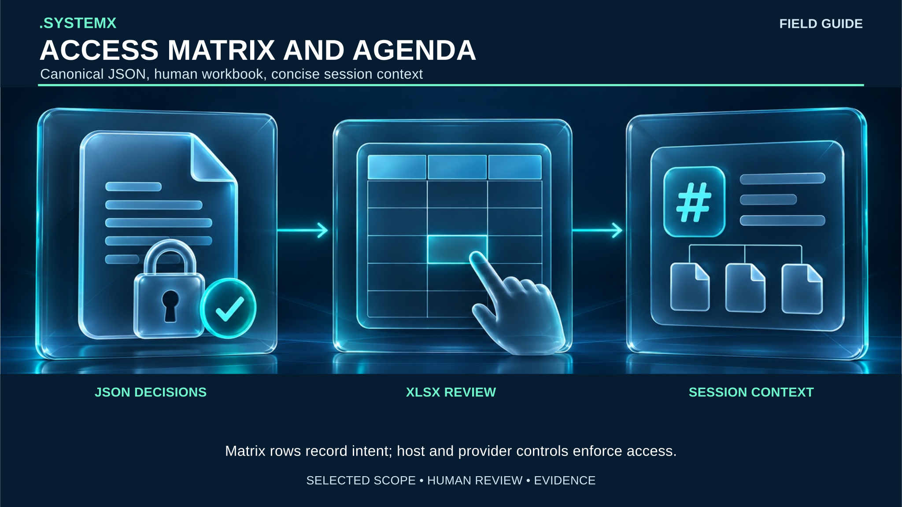

# Current visual guide and agent roles

These four guides extend the [foundational four-part field guide](systemx-field-guide.md).
Seven role cards describe the registered agent roles. The diagrams explain
file-backed responsibilities; they do not create processes or grant permissions.
Read the [current manuals](../../docs/CLI-TOOLS.md) before running a command.

Each image is a standalone SVG with selectable text, a title and description,
and one embedded generated art background. The 7680 × 4320 SVG canvas and
matching 8K raster exports provide crisp vector labels. The background art was
generated at 1672 × 941 and then scaled; the larger export does not add native
art detail. [Asset provenance](ASSETS.json) records exact hashes and dimensions.
The art uses glass panels and role accents, while every step and boundary is
also written as text. Color alone does not carry meaning.

## Four current guides

### Project lifecycle

[Full-size SVG](../Infographics/systemx-guide-lifecycle.svg). An operator first
selects a project and installs reviewed blank defaults, then activates only the
roles needed for the task. Agent 0 keeps canonical work and acceptance in
`WORK/TASKS.json`. A release tag identifies reviewed source, while a deployment
receipt records a separate target action. Update and restore use retained
receipts. A folder or role record does not start a worker or deploy a service.

### Named BOT and DOT workspaces

[Full-size SVG](../Infographics/systemx-guide-bot-workspaces.svg). Agent Beta
records one named workspace under `AGENTB/.SYSTEMXB-BOT_NAME`, including a
reviewed identity and scope. Canonical TASK references remain owned by Agent 0.
An external provider account is a separate authority. Registration does not
authenticate the bot, start a provider session, or grant an account permission.
Agent Y continues to own an explicitly selected CLI handoff.

### Security and access

[Full-size SVG](../Infographics/systemx-guide-security-access.svg). Agent1's
All-In-One policy has 20 categories with 20 questions each and ten event buckets.
Unknown and inapplicable answers do not count as passes. The local `.env` review
inventories variable names without returning values. Adding a GitHub Actions
secret requires explicit target selection and hidden terminal entry; Actions
secrets are write-only and cannot be read back to a local `.env` through a
symlink. Local execution needs a separately chosen local secret source. Findings
are advisory by default and do not prove a device is malware-free.

### Access Matrix and Agenda

[Full-size SVG](../Infographics/systemx-guide-access-matrix.svg). The selected
scope's `GLOBAL/ACCESS-MATRIX.json` is the machine-readable decision record.
The `GLOBAL/ACCESS-MATRIX.xlsx` workbook is a human review surface. Its role
rows do not themselves grant access. Agent Alpha's Agenda starts empty; the
session-settings view loads selected status and rule-file paths and hashes,
without secret values. Actual access follows the host, repository, and provider
controls in force at the time of an action.

## Agent role cards

| Role | Image and short alternative | Detailed boundary |
| --- | --- | --- |
| Agent 0 (`agent.0`) | [Coordinator and acceptance](../Infographics/systemx-agent-0.svg): a human objective and evidence return meet a central task ledger. | Owns task planning, integration, and acceptance. External actions still require actual host authority. |
| Agent X (`agent.x`) | [Events and time](../Infographics/systemx-agent-x.svg): timestamp marker, calendar and clock, and due-item card. | Records observed events and due items; it does not run a scheduler or deliver notifications. |
| Agent Y (`agent.y`) | [Bounded CLI delegate](../Infographics/systemx-agent-y.svg): assigned folder, terminal branch, and evidence package. | Executes a selected installed provider task within host permissions; no merge or task-acceptance authority. |
| Agent Z (`agent.z`) | [Evidence reviewer](../Infographics/systemx-agent-z.svg): source files, magnified checklist, and advisory scorecard. | Applies its versioned 100-question policy; its scorecard is not task acceptance or certification. |
| Agent Alpha (`agent.a`) | [Reference selector](../Infographics/systemx-agent-alpha.svg): request card, ten reference tabs, and concise result. | Routes selected AUTOBOT references. Agenda starts empty and runs no scheduler or extra model workers. |
| Agent Beta (`agent.b`) | [Named workspace recorder](../Infographics/systemx-agent-beta.svg): task record, separate workspace folders, and disconnected cloud. | Records BOT/DOT identity and scope without a provider session, login, or grant. |
| Agent1 (`agent.1`) | [Security and access reviewer](../Infographics/systemx-agent-1.svg): names-only inventory, assessment shield, and guarded terminal. | Advises on 400 questions, migration, and secrets; no device-clean guarantee. |

Agent 0 and the user retain canonical task acceptance. A native harness
subagent or a named BOT instance can be mapped to a TASK ID, but neither becomes
one of these seven role registrations merely by appearing in a diagram or
workbook. The [Access Matrix guide](../../docs/ACCESS-AND-MAP.md) and
[Agent Beta, Agent1, and Agenda specification](https://github.com/WayneTechLab/dotSYSTEMX/blob/v1.11.0-beta.1/docs/agent-beta-security-agenda.md)
provide the operational details.
