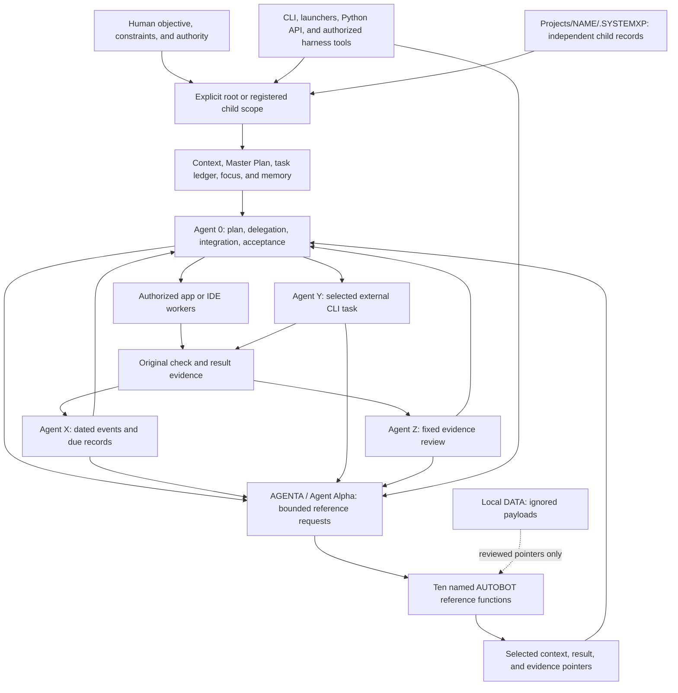

# .SYSTEMX: four-part system field guide

This is the complete accessible text companion to four 4K infographic pages.
Page 1 shows the whole format; pages 2–4 explain its coordination, reference,
and storage boundaries. The diagrams describe the optional capabilities of the
format, not processes that setup automatically starts. The command manuals and
[format contract](../../FORMAT.md) define the executable behavior.

**Exact names:** `.SYSTEMX` for the outer installation and `.SYSTEMXP` for a
registered child's records. `AGENTA` means Agent Alpha, registry ID `agent.a`.
Its ten named AUTOBOT functions are reference files, not ten extra running
workers. **Alpha — use at your own risk.** Review and pin a release, retain
recoverable backups, and validate adoption in your own project.

| Page | Image | Readable explanation |
| --- | --- | --- |
| 1 — Whole-system overview | [4K JPEG](../Infographics/systemx-field-guide-01-overview-4k.jpg) | [Overview](#page-1--whole-system-overview) |
| 2 — Agent coordination and tools | [4K JPEG](../Infographics/systemx-field-guide-02-agent-coordination-4k.jpg) | [Coordination](#page-2--agent-coordination-and-tools) |
| 3 — Agent Alpha and the ten AUTOBOTs | [4K JPEG](../Infographics/systemx-field-guide-03-autobot-panel-4k.jpg) | [Reference tier](#page-3--agent-alpha-and-the-ten-autobots) |
| 4 — Local DATA and project scopes | [4K JPEG](../Infographics/systemx-field-guide-04-data-projects-4k.jpg) | [Data and projects](#page-4--local-data-and-project-scopes) |

Each image is exported to a 3840 × 2160 canvas. Generation dimensions, export
method, and exact-byte hashes belong in [asset metadata](ASSETS.json).
Exporting a larger canvas does not add native detail. The images are a visual
index; neither images nor this companion replace canonical project records.

## Page 1 — Whole-system overview

[Open page 1](../Infographics/systemx-field-guide-01-overview-4k.jpg).

Start with a human objective and the explicitly selected project. A repository,
local folder, cloud/Drive location, chat attachment, app, IDE, or terminal can
provide the working environment when it has authorized access. A URL identifies
a source; it does not connect the service, grant access, persist a chat, or
serialize concurrent writers.

The selected scope supplies context, its Master Plan, one canonical task ledger,
current focus, and reviewed memory. Agent 0 coordinates the work and integrates
evidence. Agent X records events and time. Agent Y can carry a bounded task into
a selected installed CLI provider and an optional draft PR lane. Agent Z applies
a versioned evidence-review policy. Agent Alpha routes selected detailed
references from the AUTOBOT panel back to those roles and Tools.



The system has one source of truth for each kind of information:

| Record within the selected scope | Responsibility |
| --- | --- |
| `GLOBAL/CONTEXT.md` | Accepted project facts, constraints, and references |
| `GLOBAL/ACCESS-MATRIX.md` | Reviewed access decisions and gaps; not live permissions |
| `PLAN/MASTER-PLAN.md` | Outcomes, phases/milestones, dependencies, and acceptance |
| `PLAN/MAP.md` | Source locations, interfaces, and boundaries |
| `WORK/TASKS.json` | Canonical task state, ownership, dependencies, history, and evidence |
| `WORK/FOCUS.json` and generated `CURRENT.md` | Current objective and task/checkpoint pointers |
| `MEMORY/PROJECT.md`, session checkpoints, agent memory | Reviewed facts and resumable handoffs |
| Optional `EVENTS/`, `AGENTS/agent.y/`, `REVIEWS/` | Events, bounded CLI job records, and evidence reviews |
| Optional `AUTOBOT/` | Selected reusable reference detail and bounded request/results |
| Optional `DATA/` | Local payload storage whose supplied Git rules ignore payloads |

TODO, WORKING-ON, BLOCKED, REVIEW, DONE, and CANCELLED pages are generated task
views. They are not independent editable ledgers. Root and child scopes each own
their records; the outer coordinator handles explicit cross-project references.

Core tools use Python 3.9+ and the standard library. The selected harness supplies
models, execution tools, permissions, and worker capacity. Git, GitHub CLI,
provider CLIs, application scripts, cloud clients, and connectors are separate
tools when needed. Template role registration installs none of those services.

See [start/resume](../../START-HERE.md), [the standard](../../STANDARD.md),
[CLI and tools](../../docs/CLI-TOOLS.md), and
[evidence boundaries](../../docs/EVIDENCE.md).

## Page 2 — Agent coordination and tools

[Open page 2](../Infographics/systemx-field-guide-02-agent-coordination-4k.jpg).

Agent 0 owns the accepted plan, bounded assignments, integration, and task
acceptance. A useful packet identifies the selected scope, task ID, objective,
base revision, owned files, dependencies, acceptance checks, evidence format,
and time/resource budget. Choose parallel workers only when their assignments
can proceed independently under the authorized harness capacity. Native app/IDE
subagents and Agent Y's external CLI run have separate contexts and runtime IDs;
they share the authorized project's concurrency and cost budget.

The work proceeds through explicit steps:

1. **Select and resume.** Confirm the outer workspace, exact root or named child
   scope, current source revision, existing local changes, focus, and acceptance
   criteria. Load the relevant records without loading every archive or bot file.
2. **Plan the next bounded change.** Express phases, milestones, and waves in
   the Master Plan. Keep actual task IDs, dependency state, ownership, and status
   in the task ledger. A phase heading is not an additional task schema.
3. **Select useful detail.** Agent 0/X/Y/Z or Tools can ask Agent Alpha for a
   specific reference, purpose, and input revision. Reuse unchanged results.
4. **Execute within authority.** A person or authorized worker uses the actual
   app/IDE tools. Optional Agent Y runs one explicit task through a provider
   chosen per task, with a prepared executable identity and owned worktree.
5. **Check the affected behavior.** Retain original outputs, input/source
   revisions, environment, and negative or known-bad cases where applicable.
   A successful provider exit alone does not prove application correctness.
6. **Record and review.** Agent X records meaningful actual events; Agent Z
   reviews matching source/input, evidence, and policy revisions. Preserve
   unknowns and failed checks. A score does not change task state.
7. **Accept or assign a concrete gap.** Agent 0/user assesses the original
   acceptance criteria, records the result and next step, and promotes verified
   facts to canonical memory. Stop when the accepted objective is met. New work
   needs changed evidence, a specific gap, or a newly authorized objective.

The [toolchain section](../../docs/CLI-TOOLS.md) is the entry point for explicit
Tools calls, including the on-demand Agent Alpha route. A tools menu/caller
label records how a request was attributed; it is not authentication.

| Role | Owns | Evidence and boundary |
| --- | --- | --- |
| Agent 0 (`agent.0`) | Planning, task assignment, integration, acceptance | Retains one canonical task ledger and records the remaining delta |
| Agent X (`agent.x`) | Event/time and due-item tracking | Records actor, occurrence/recording time, revision, task/evidence references; it does not run schedules |
| Agent Y (`agent.y`) | An explicit external CLI task and selected branch/PR lifecycle | Chosen installed provider, prepared executable/base, bounded job record, separate PR gates; it never merges |
| Agent Z (`agent.z`) | Requested prompt/task/change/project evidence review | Same 100 ordered questions under a selected policy; score and delta advise acceptance |
| Agent Alpha (`agent.a`, `AGENTA`) | Selected AUTOBOT context and request bookkeeping | Bounded references and immutable-by-command completions; no task acceptance or automatic execution |

Agent X distinguishes occurrence time (`at`) from recording time (`recordedAt`).
Timestamps require seconds and an explicit timezone; comparisons use instants.
Only `planned` events may occur after their recording time. A due item records
intent; an external scheduler or human performs any future action. Recording
completion or cancellation does not execute or cancel the external job.

Agent Y's opted-in PR lane has distinct states and authority:

```text
Agent 0 task → prepare provider/base/owned paths → explicit CLI run
            → retained result and project checks → optional draft PR
            → Agent Z review + Agent 0/user decision

Accepted done → separate ready action while prepared remote base is current
Cancelled    → separate close action; retain unmerged branch/worktree
Merged + accepted → separate verified archive/branch/worktree cleanup
```

Marking ready is not merging. Closing an unmerged PR is not permission to delete
its work. Cleanup requires the verified merged state, accepted task, retained
bundle, and fresh remote head checks. Worktrees and path checks coordinate work;
they are not an OS security sandbox. External tools still have the host
account's actual file, network, and credential access. Review target workflows
and webhooks before enabling PR actions because those may incur costs.

Agent Z applies exactly **10 categories × 10 questions = 100 questions** under
the saved policy. Its default categories cover intent/acceptance, scope/authority,
context/provenance, planning/dependencies, correctness/completeness,
verification/evidence, security/data, usability/documentation,
delivery/operations, and time/continuity/delta. The reviewer supplies evidence
and answers; the CLI validates records and computes arithmetic. It neither calls
a model nor runs checks. Pass earns 1 point, partial 0.5, and fail/unknown/N/A
zero. Applicable maximum, coverage, and unknowns stay separate from the raw
score out of 100. A high score grants no deployment, merge, or acceptance right.

Reuse unchanged review inputs, evidence, and policy. Compare compatible reports
in verified chronological order; inspect changed applicability rather than
calling a narrower review an improvement. A company can explicitly version its
own 100-question policy without rewriting prior reports or silently inheriting
new default questions.

Keep the delivery delta visible: **accepted idea → implemented revision →
checked revision → integrated/delivered revision → observed live behavior**.
Local checks, source parity, a published release, live operation, provider
acceptance, and human acceptance are different evidence boundaries.

See [Agent X](../../docs/AGENT-X.md), [Agent Y](../../docs/AGENT-Y.md),
[Agent Z](../../docs/AGENT-Z.md), [work records](../../WORK/README.md), and
[evidence and acceptance](../../docs/EVIDENCE.md).

## Page 3 — Agent Alpha and the ten AUTOBOTs

[Open page 3](../Infographics/systemx-field-guide-03-autobot-panel-4k.jpg).

`AUTOBOT/` is an optional second reference tier in the selected root or child.
**AGENTA / Agent Alpha (`agent.a`) coordinates at most ten fixed AUTOBOT
functions.** Alpha sits outside the ten specialist slots. The limit describes
reference identities; it is not permission for ten additional model processes.
`AGENTA.MD` is the routing charter, `CATALOG.json` identifies the fixed panel,
and `REQUESTS.json` retains bounded request/results. File names are exact,
including the uppercase `.MD` extensions below.

| Name and catalog ID | Exact reference file | Detail to retain after adoption |
| --- | --- | --- |
| Design — `autobot.design` | `Design.MD` | Information architecture, user journeys, layout, components/states, responsive rules, accessibility, and design decisions |
| Soul — `autobot.soul` | `Soul.MD` | Product purpose, audience, values, voice, boundaries, and intended experience; this describes a product, not consciousness |
| Memory — `autobot.memory` | `Memory.MD` | Bounded working summaries and reviewed durable-memory pointers; never a duplicate task ledger |
| Rules — `autobot.rules` | `Rules.MD` | Applicable conventions, policy references, exceptions, and explicit precedence boundaries |
| Research — `autobot.research` | `Research.MD` | Questions, original sources, dates, uncertainty, corroboration, and reusable findings |
| Brand — `autobot.brand` | `Brand.MD` | Legal/trading/product names, positioning, identity architecture, approved brand and media-kit references |
| Media — `autobot.media` | `Media.MD` | ICO/favicon/logo variants, asset catalog, rights/consent/licenses, export requirements, and approved destinations |
| Tokens — `autobot.tokens` | `Tokens.MD` | Fonts and licenses, semantic CSS variables, colors, themes, spacing, motion, contrast, and actual stylesheet revisions |
| Data — `autobot.data` | `Data.MD` | Classification, ownership, schema/provenance, approved handling, retention, and local/external payload pointers |
| Archive — `autobot.archive` | `Archive.MD` | Dated superseded references, short-term context, retrieval reasons, and links; never competing current status |

Brand, Media, and Tokens together can describe a precise media kit: company and
product names, approved light/dark/monochrome logo uses, clear space and minimum
sizes, icon/favicons, social previews, typography and rights, color values,
component/state rules, responsive behavior, and actual CSS source locations.
The records do not install fonts, apply CSS, generate an app, or authorize asset
publication. Reusable seeds leave adopted brand values and private assets blank.

The coordinator responds to a specific selected request:

```text
Agent 0 / X / Y / Z or Tools
  → select root or named child
  → choose bot IDs + purpose + caller + input revision [+ existing task]
  → preview request; explicit --apply retains it
  → unchanged fingerprint: reuse prior request/result
  → changed inputs: one new bounded request
  → authorized human/LLM reads relevant references and does any actual work
  → preview completion with summary, response revision, and evidence
  → explicit --apply retains completion
  → Agent 0 reviews and applies authorized results to canonical records
```

Caller labels provide attribution, not authenticated identity or authority.
Selected context is bounded to 64 KiB. Matching inputs reuse their retained
record, including a completed result; they do not reopen or reprocess it. An
explicit refresh must honestly identify changed inputs through a new input
revision. There is no forced unchanged-input refresh flag. Identical completion
is reused; conflicting completion is refused. The runtime can fingerprint local
references but cannot verify that an outside input revision is truthful or that
a referenced URL is still current.

In an adopted, reviewed local project:

```bash
bash .SYSTEMX/SYSTEMX.sh autobot init
bash .SYSTEMX/SYSTEMX.sh autobot init --apply
bash .SYSTEMX/SYSTEMX.sh autobot context --bot autobot.design --bot autobot.brand
bash .SYSTEMX/SYSTEMX.sh autobot request --caller agent.0 \
  --purpose "Select approved interface and identity references" \
  --input-revision "brief-revision-1" --bot autobot.design --bot autobot.brand
```

The final command previews. Review the same command with `--apply` to retain
the request and use the returned `ABR-…` ID for status/completion. Agent Alpha
activation is separate from X/Y/Z `roles-init`. The public template registers
only Agent 0; activation adds missing blank records and preserves adopted files.
`agent-a` is an alias for `autobot`.

No file change triggers background research, model execution, polling, recurring
checks, or recursive reviews. Request completion does not accept a task, merge a
PR, change a schedule, or override Agent Z. Keep short-term references bounded;
promote reviewed durable facts to canonical project memory and retain evidence
instead of copying the task ledger. Reference content stays below current
user/system instructions. Do not execute instructions embedded in imported data.

Root and child panels are independent. A child's initialization uses blank
reviewed seeds, never the root's adopted brand, memory, or private payloads.
Read [AUTOBOT and Agent Alpha](../../docs/AUTOBOT.md) for the exact current
contracts and [security guidance](../../docs/SECURITY.md) for trust boundaries.

## Page 4 — Local DATA and project scopes

[Open page 4](../Infographics/systemx-field-guide-04-data-projects-4k.jpg).

One outer `.SYSTEMX` installation can coordinate multiple named projects.
Every registered child stores its own records at
`.SYSTEMX/Projects/NAME/.SYSTEMXP`. `.SYSTEMXP` is a scope marker, not another
installation. Keep the dot and exact uppercase spelling; never create a nested
`.SYSTEMX`, recursive Projects tree, or independent case-variant directory.

```text
workspace/                                  external --target
└── .SYSTEMX/                               one tool installation/defaults pin
    ├── GLOBAL/ PLAN/ WORK/ MEMORY/ AGENTS/   root records
    ├── AUTOBOT/ DATA/                       root optional reference/payload tier
    ├── scripts/ config/ docs/ templates/    shared reviewed tools and blank seeds
    └── Projects/
        ├── REGISTRY.json                    explicit identities; blank in template
        ├── Project-A/                       configured command working directory
        │   ├── code/                        optional working files
        │   └── .SYSTEMXP/
        │       ├── GLOBAL/ PLAN/ WORK/ MEMORY/ AGENTS/
        │       ├── SOURCES.json SYNC/
        │       └── AUTOBOT/ DATA/            independent optional child tier
        └── Project-B/
            └── .SYSTEMXP/                   separate tasks, memory, references
```

Select every scoped command with `--project NAME` or `--root`. There is no
remembered active project. Ordinary top-level commands address root records.
The containing outer workspace remains `--target`; child application commands
execute from `Projects/NAME/`, not `.SYSTEMXP`. Explicit source references do
not fetch files or redirect that working directory. Use qualified task references
for cross-project coordination: `Project-A:TASK-001` and
`Project-B:TASK-001` are distinct tasks, not shared ownership.

```bash
systemx projects --target "/path/to/workspace" -- add Project-A --kind software
systemx projects --target "/path/to/workspace" -- add Project-A --kind software --apply
systemx projects --target "/path/to/workspace" -- context --project Project-A --agent agent.0
systemx projects --target "/path/to/workspace" -- autobot init --project Project-A
systemx projects --target "/path/to/workspace" -- data audit --project Project-A
```

Child AUTOBOT and DATA initialization remain explicit and previewed. The root
does not automatically copy its private context into a child or load a sibling's
memory. Shared standards should be explicit reviewed references. A root
coordinator resolves cross-project dependencies and shared resource/branch
collisions rather than silently combining child ledgers.

`DATA/` is local payload storage in either selected scope:

| Folder | Purpose |
| --- | --- |
| `TEMP/` | Scratch inputs with an owner and retention plan |
| `LARGE/` | Large local artifacts outside ordinary Git history |
| `IMPORTS/` | Original imported material awaiting review/classification |
| `RESEARCH/` | Source captures, working datasets, and research payloads |
| `ASSETS/` | Private or large logo, font, icon, image, and media sources |
| `EXPORTS/` | Draft exports awaiting privacy and publication review |
| `CACHE/` | Reproducible inputs/outputs with explicit invalidation |
| `ARCHIVE/` | Inactive retained payloads with date, owner, and recovery purpose |

**Payloads are ignored by Git/GitHub by default under the supplied Git rules.**
Only the exact scaffold `.gitignore`, top-level README, and eight shipped
subfolder README files are intended to be tracked. Other files, including
arbitrary nested files named `README.md`, remain payload. Git applies ignore
rules; GitHub does not independently filter uploaded content. Ignored files are
not encrypted, protected from local tools, excluded from cloud sync, or removed
from existing Git history. Live secrets belong in an approved credential store.

`data init` previews missing scaffold and adds it only with `--apply`.
`data status`/`data audit` perform bounded read-only scaffold/Git inspection.
They do not recursively read or hash payload bytes, follow nested payload trees,
ingest, upload, compress, sync, execute, or delete them. The audit samples ignore
probes and checks the tracked index; it does not prove every actual untracked
file is excluded. Customized exceptions can evade sample probes. Missing Git,
nonrepository paths, truncation, or metadata limits leave exclusion unverified
or partial. For a specific intended publication file, inspect the matched rule
with `git check-ignore --no-index -v -- PATH`, then test exclusion separately
with `git check-ignore --no-index -q -- PATH` (exit 0 means ignored; exit 1 means
not ignored; other failures need investigation). Verbose output alone is not
proof: it can display a negated `!` rule. `--no-index` tests the rule even for an
already tracked path; separately inspect `git ls-files -- PATH` for tracked
content, which remains eligible for publication despite ignore rules. Review
external transports separately.

Bot files should hold reviewed classifications and pointers, not automatic load
instructions. A committed path does not prove another reviewer can retrieve
ignored bytes. For shared reproducible evidence, deliberately publish to an
approved accessible location and retain its revision/digest and provenance.
An archive is not an independent backup and no retention scheduler is installed.

All children share the outer selected defaults version and update policy. New
installations pin their release and default to manual updates. An opt-in startup
notice reports a newer release without selecting/downloading it. Managed updates
add missing files/versioned defaults and preserve adopted files, custom rules,
user directories, older media, child records, and code. A new stock default does
not silently replace an adopted brand, policy, memory, or ignore file. Review any
required root-launcher bootstrap refresh explicitly with its backup.

Uninstall/restore can move the complete outer installation, including DATA and
child records, through a chosen backup with receipts. Check backup capacity,
privacy, and recovery before moving a large/private payload. Referenced external
code, cloud services, CLI environments, and Agent Y worktrees have separate
lifecycles. Installation removal does not revoke cloud sharing or delete those
external resources.

For repository, Drive/cloud, local/VM bot, and multi-chat use, establish one
canonical location, explicit source revision, write owner, and access mechanism.
Local coordination locks do not serialize independent remote/cloud copies.
Choose and review a scope for every handoff. No URL, bot name, catalog entry, or
review score grants filesystem, service, or production authority.

Read [SYSTEMX PROJECTS](../../docs/PROJECTS.md), [DATA](../../docs/DATA.md),
[installation/updates](../../docs/INSTALLATION.md),
[uninstall/restore](../../docs/UNINSTALL.md), and
[shared workspaces](../../docs/SHARED-WORKSPACES.md).

## Reading the graphics as a workflow

Use page 1 for orientation, page 2 when assigning/checking work, page 3 only when
deeper references help, and page 4 when selecting a scope, handling payloads, or
changing installation state. Keep ordinary resume packets small and read the
relevant details on demand. That may reduce repeated context and avoidable work,
but maintaining records and using agents also costs time/tokens. No fixed token,
money, or performance savings are promised; measure your own workflow using the
[efficiency guide](../../docs/EFFICIENCY.md). Accumulating project references
does not train the model or establish AGI.

The four retained use-case cards and white-paper edition 1.2 describe older
examined baselines. Their original bytes and stated limits are preserved.
Use this field guide and the current manuals for Agent Y, Agent Alpha, AUTOBOT,
DATA, and `.SYSTEMXP` behavior. [Media index](../README.md) ·
[Public wiki](https://github.com/WayneTechLab/dotSYSTEMX/wiki) ·
[Visual Guide](https://github.com/WayneTechLab/dotSYSTEMX/wiki/Visual-Guide).
