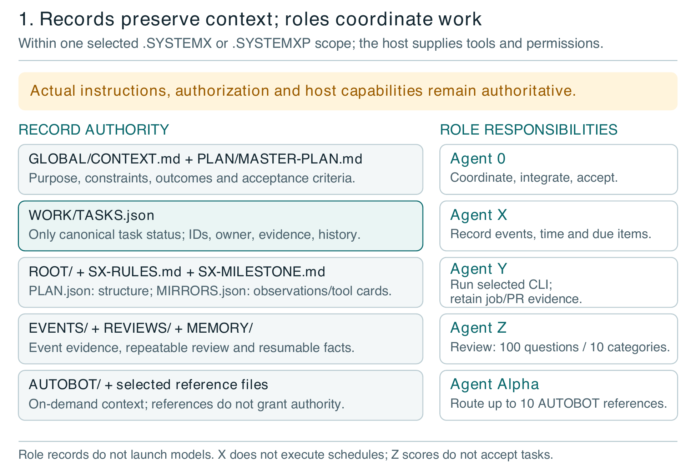
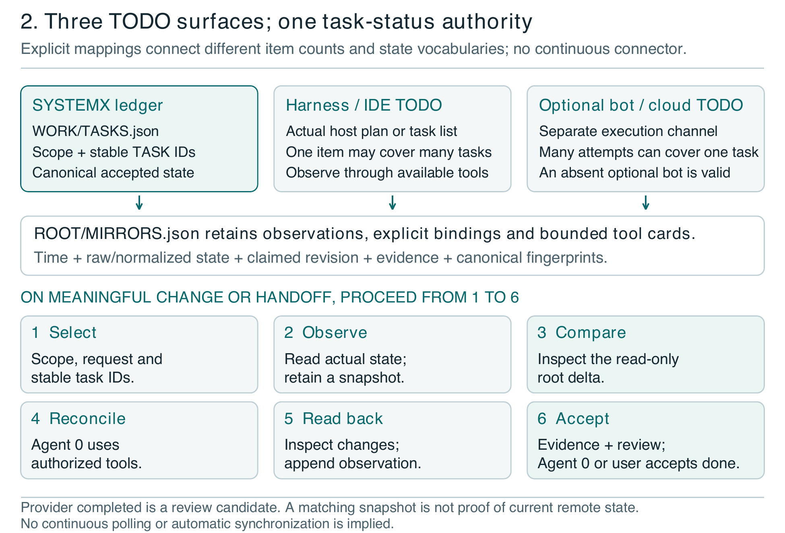
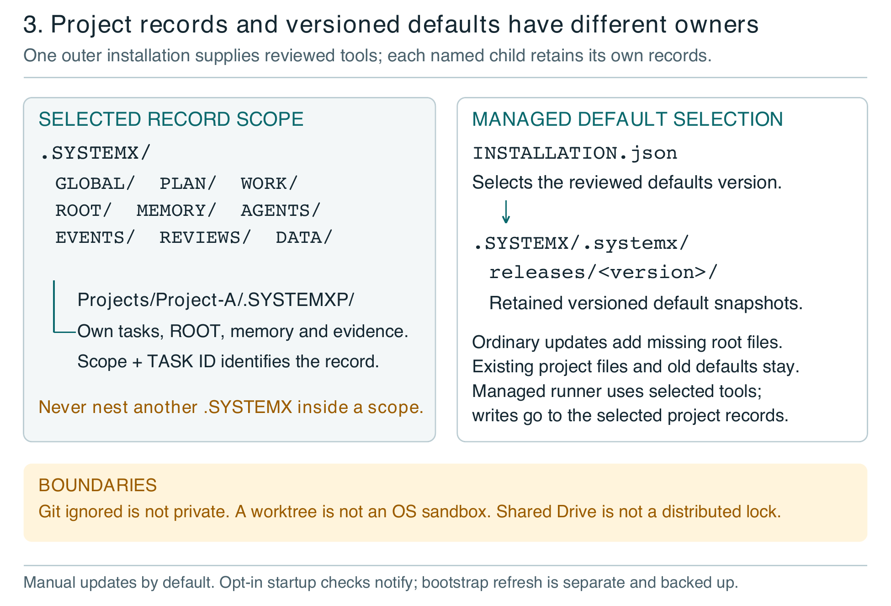
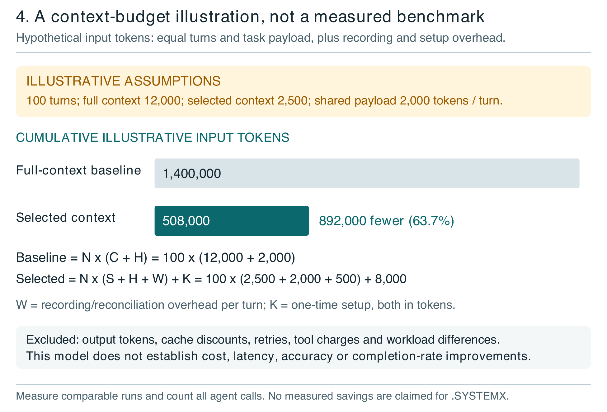

# .SYSTEMX

**Identity.** Edition 2.0. Prepared 20 October 2026 by Lucas (SatoshiUNO). A product of Wayne Tech Lab LLC. Portfolio: [Networks.Chat](https://Networks.Chat). Business: [WayneTechLab.com](https://WayneTechLab.com). [Source repository](https://github.com/WayneTechLab/dotSYSTEMX). [User manual](https://github.com/WayneTechLab/dotSYSTEMX/wiki).

**Technical scope.** The examined implementation is `1.11.0-alpha.4`, commit `e086ba15a1e70c6b585b8f12a703defc5c984b2c`. The publication edition and the template version are different identifiers. This is a public technical white paper, not an external standard, independent peer review, effectiveness study, or production certification. Alpha interfaces may change; use at your own risk.

## Publication context

### Abstract

.SYSTEMX is a portable record and coordination format for AI-assisted projects. It keeps an accepted objective, a master plan, canonical tasks, selected memory, and verification evidence in a versioned folder. Its purpose is to reduce the reconstruction and conflicting assumptions that can arise when work spans people, sessions, models, and tools. Agent 0 coordinates work and acceptance; Agent X records time and events; Agent Y manages explicitly delegated external CLI work; Agent Z scores a fixed review questionnaire; Agent Alpha routes selected reference material. An optional ROOT layer connects planning structure with observations of harness and bot TODOs without creating another task-status authority. This paper explains the implemented architecture, adoption patterns, trust boundaries, and a reproducible local walkthrough against version 1.11.0-alpha.4. It presents an illustrative input-token model and a proposed evaluation protocol, rather than claiming measured savings. .SYSTEMX remains experimental alpha software: its records support accountable work, while execution, permissions, judgment, and final acceptance remain with the host and its authorized users.

**Audience.** Founders, project leads, developers, researchers, and operators of AI-assisted tools. Technical detail is introduced after the operating model; the repository and wiki provide the full manual.

## 1. Purpose and design position

.SYSTEMX keeps the accepted objective, current work, and verification evidence in a portable project folder so people and AI tools can resume with less reconstruction. The creator describes its origin as a way to keep local scripts and TODO records consistent during project work. The current format extends that practical idea into explicit ownership, scoped context, delegated work, events, and repeatable review. This origin is the creator's account, not a longitudinal research finding.

A long project has several kinds of truth. The user has an intended outcome. A plan describes how to reach it. A task ledger records current work. A tool produces an observed result. A deployment changes a particular environment. A reviewer or owner accepts a result against criteria. Confusing these states creates avoidable work: a successful local command can be mistaken for a live deployment, or a worker's completion message for accepted delivery.

The design proposition is to give those distinctions durable, inspectable records. The format does not make a model remember automatically. A new session must have authorized access to the records, select the relevant scope, and read them. A URL identifies a location; it does not establish access, freshness, or write capability. ([WayneTechLab, "Release"](#cite-release))

Research supplies motivation, not proof of effectiveness. Liu and colleagues found position-sensitive use of long context in the models and tasks they studied. ReAct investigated iterative interaction with external observations. Engineering accounts from Anthropic and OpenAI describe practical coordination and repository-knowledge challenges. None evaluates .SYSTEMX or establishes its savings. ([Liu et al.](#cite-liu); [Yao et al.](#cite-react); [Hadfield et al.](#cite-anthropic); [Lopopolo](#cite-harness))

## 2. System boundary and record architecture

A model generates outputs. A **harness** is the application or environment that presents instructions and exposes tools, such as an IDE, chat application, or terminal agent. The operating system, tool permissions, credentials, and service policies determine what can actually execute. .SYSTEMX supplies records and coordination conventions within that environment. A role name or Markdown rule cannot grant access.


*Fig. 1. Record authority and agent responsibilities. Author's schematic from the pinned implementation. Execution and permission remain host-controlled; supporting roles do not form an automatic chain of executors.*

| Location in the selected scope | Responsibility |
| --- | --- |
| `GLOBAL/CONTEXT.md` | Purpose, constraints, source hierarchy, and shared project facts. |
| `PLAN/MASTER-PLAN.md` | Accepted outcomes, milestone criteria, dependencies, and sequencing. |
| `WORK/TASKS.json` | Canonical task IDs, owners, statuses, acceptance conditions, evidence, and review history. |
| `WORK/FOCUS.json` and generated views | A bounded current selection and readable views derived from the ledger. |
| `MEMORY/` and selected agent memory | Accepted durable facts, decisions, and resumable checkpoints. |
| Optional `ROOT/`, event, job, and review records | Planning relationships and evidence about coordination, execution, and review. |

**Canonical** means the designated authority for a particular record. `WORK/TASKS.json` is the task-status authority; generated TODO, working, review, blocked, done, and cancelled views are projections. The master plan is an outcome map, not a competing status database. The public template ships blank project records, with only Agent 0 registered. An adopting project supplies its own facts. ([WayneTechLab, "Task Ledger"](#cite-ledger))

## 3. Stable tasks, flexible plans

Each independently owned and accepted unit of work receives a stable `TASK-...` identity. Its record needs a scope, owner, concrete acceptance condition, dependencies where relevant, and next action. Reorganizing a plan should not change that identity. A small checklist action can stay within one task; independently accepted work needs its own canonical record.

The six canonical states are `todo`, `in_progress`, `blocked`, `needs_review`, `done`, and `cancelled`. A typical route is TODO, active work, review, then done. Blockers and cancellations retain reasons. Dependencies constrain progress. `done` requires the established evidence and review transition, with reviewer `agent.0` or `user`; a score, exit code, or external completion flag does not satisfy it automatically. These are cooperative record rules, not authentication of the person or model supplying a reviewer label. ([WayneTechLab, "Task Ledger"](#cite-ledger))

ROOT separates **request provenance** from **plan structure**. An RTask identifies an originating user or authorized harness request. An STask identifies a bounded child, follow-up, or delegated request. Neither is a task status or a requirement to launch another agent. Planning may use milestone, wave, phase, optional group, task, optional subtask, and single action. A wave groups phases; levels and counts follow the project. Declare milestone IDs in the master plan before linking tasks and ROOT nodes to them. ([WayneTechLab, "ROOT"](#cite-root))

The hierarchy should scale down. A small fix may need one request and one task. Multiplying five levels of ten items by three final actions yields 300,000 actions; this arithmetic is not a reason to generate an empty backlog. Expand the next useful slice as evidence reduces uncertainty. Parallel work depends on valid dependencies, ownership, available tools, and resource limits, rather than the names of plan levels.

## 4. Agent roles and selected reference material

The roles describe responsibilities. Creating their records does not start a model or background service. Native subagents supplied by an application and external CLI workers are different execution channels; their context, permissions, and availability must be established separately.

| Role | Implemented responsibility and boundary |
| --- | --- |
| Agent 0 | Coordinates the accepted plan, bounded assignments, integration, and acceptance. Native agent execution depends on the harness. |
| Agent X | Retains events, occurrence and recording times, and due items. Separate host tooling must execute schedules. |
| Agent Y | Prepares and explicitly runs a selected installed CLI in an owned worktree, retaining job evidence and gated PR lifecycle records. |
| Agent Z | Presents a fixed policy and computes scores from supplied answers and evidence references. It does not execute the checks itself. |
| Agent Alpha, `agent.a` | Routes explicit requests to selected AUTOBOT references and reuses matching retained records or results. |

Agent Y is an execution path when an authorized provider run is applied. Its selected CLI does not inherit an app's chat automatically. Provider configuration, file scope, acceptance checks, and PR policy belong in the handoff. Draft PR creation is opt-in. Acceptance, readiness, cancellation, verified merge, backup, and branch cleanup are separate gates; there is no controller merge command. A Git worktree is not an operating-system sandbox, and CLI permissions remain those of its environment. ([WayneTechLab, "Agent Y"](#cite-y))

Agent Z's default policy has ten categories and ten stable questions per category. A human or authorized LLM supplies the answers. A pass earns one point, partial half a point, and fail or unknown zero; not-applicable answers are excluded from the applicable denominator. The report exposes points, applicability, coverage, and answer counts. An all-not-applicable review does not become a perfect review. Comparisons require compatible subjects and policy fingerprints, and preserve ordering and applicability caveats. There is no universal passing threshold or automatic task acceptance. ([WayneTechLab, "Agent Z"](#cite-z))

AUTOBOT contains ten reference slots: `Design.MD`, `Soul.MD`, `Memory.MD`, `Rules.MD`, `Research.MD`, `Brand.MD`, `Media.MD`, `Tokens.MD`, `Data.MD`, and `Archive.MD`. Alpha is outside those ten slots. The files describe selected design, purpose, research, policy, brand, media, CSS-token, data, or archival context; they are not ten running models. A purpose, input revision, and source fingerprint support reuse. Changed inputs need a new explicit request, rather than an automatic refresh loop. ([WayneTechLab, "AUTOBOT"](#cite-alpha))

## 5. ROOT and the three TODO surfaces

`ROOT/SX-RULES.md` defines the internal operating contract. `ROOT/SX-MILESTONE.md` explains planning, tool cards, and comparison. `ROOT/PLAN.json` retains requests and structural nodes; `ROOT/MIRRORS.json` retains external-item bindings, observations, and cards. These optional records do not create another task ledger or execute provider synchronization.

The three possible surfaces are the canonical SYSTEMX task ledger, the actual IDE or harness TODO list, and an optional cloud or bot run. They need not contain the same number of items. One harness phase may summarize several canonical tasks; one task may have several external attempts. Explicit bindings retain scope, channel, item identity, and canonical task IDs.


*Fig. 2. On-demand reconciliation, not a live connector. Saved observations and canonical fingerprints feed a read-only delta. Actual authorized tools perform external writes; evidence and acceptance remain separate.*

1. Select the scope, originating request, and affected canonical tasks.
2. Read actual external plan or run state through authorized host tools.
3. Retain the binding, original observation time, raw and normalized state, source revision, and evidence reference.
4. Run the read-only delta to expose missing, unavailable, unknown, different, or stale information.
5. Have Agent 0 reconcile the affected differences through normal canonical task commands and available external tools.
6. Read back external changes and retain a fresh observation.
7. Review the evidence, accept when the criteria are met, checkpoint, and stop until a meaningful change or handoff.

ROOT compares an external item's state with the aggregate of all tasks bound to it. If one bound task is done and another in progress, the expected external state is running. Fingerprint checks include bound tasks outside a selected output slice. The bot layer is opt-in; omitting it leaves it unassessed. A local report cannot establish live synchronization: source revisions are caller assertions, and ROOT does not fetch or authenticate the external system. If a native revision is unavailable, label an exact captured snapshot digest honestly, or retain the unverified gap. Never substitute repository HEAD as the revision of an IDE's plan. ([WayneTechLab, "ROOT"](#cite-root))

## 6. Worked example: a twenty-page web application

Consider a founder requesting a twenty-page web application. A useful initial brief defines the audience, page inventory, user journeys, content sources, design constraints, data handling, available tools, budget, and observable acceptance criteria. A deep research brief can improve the available evidence; more text alone does not guarantee better decisions. Retain concise findings and source pointers rather than hidden model reasoning.

The master plan can separate discovery, design, the shared application shell, page groups, integration, and verification. Agent 0 assigns independent page groups only after shared interfaces are clear. A native subagent may work through the IDE; an explicitly selected Agent Y job may use a separate CLI. Alpha supplies only relevant brand, design, or token references. Agent X records significant events and observations. Agent Z reviews supplied evidence. Agent 0 integrates and accepts the result. A live deployment needs its own authorized action and readback; local checks cannot establish it.

The operational trace is deliberately smaller than that application. This edition includes a provider-free verifier that creates a disposable managed project, creates canonical tasks and request structure, and binds one **synthetic harness item** to two tasks. After the first task is accepted and the second is active, delta expects running. A subsequent change to the second task makes the old observation stale, even when a report selects only the first task.

A synthetic external completed observation leaves the second canonical task in progress. Premature completion and missing-reviewer attempts are refused without changing the ledger. A deliberately invalid evidence fixture fails its check; its valid counterpart passes. A future occurred event is refused while the same future time is permitted for a planned event. This is a test of record behavior, not a generated twenty-page app, real harness readback, or model-performance experiment.

Run from a reviewed repository checkout with Python 3.9 or newer:

```bash
python3 -I -B docs/media/verify_white_paper_v2.py
```

Both Python 3.9 and 3.14 runs against the examined baseline completed 30 local CLI commands and the stated positive and refusal checks. The verifier prints sanitized commands, return codes, returned IDs, and evidence digests, then removes its temporary project. Appendix B explains what this result does and does not establish.

## 7. Adoption across repositories, chats, and projects

The exact outer folder name is `.SYSTEMX`, including the leading dot and uppercase letters. A leading dot conventionally hides a directory in Unix-like file browsers; it is not access control and does not universally hide a folder on every operating system. Case-sensitive systems can hold both `.SYSTEMX` and `.systemx`. Setup therefore inspects existing paths and can offer a relative lowercase compatibility link where supported; it must not silently merge independent directories.

An outer installation can track named children at `.SYSTEMX/Projects/Project-A/.SYSTEMXP` and Project B's separate scope. Each scope has its own context, plan, tasks, memory, and optional ROOT or reference tier. Children reuse the outer tools and selected defaults; they do not contain nested `.SYSTEMX` installations. Carry scope with each task ID: `Project-A:TASK-001` and `Project-B:TASK-001` are distinct identities. Cross-project dependencies need explicit coordination. ([WayneTechLab, "Projects"](#cite-projects))


*Fig. 3. Scope and lifecycle boundaries. A registered child has independent records. Versioned defaults do not become shared project memory, and an update does not overwrite existing adopted files.*

In a chat-only environment, an authorized attachment or current export can carry context, but the model must not claim it saved changes without a write tool and readback. In a repository, commits provide inspectable versions. A local CLI or bot can use the same record convention through actual filesystem tools. A Drive or cloud folder can be a shared location when authorized transport exists. None provides conflict-free multi-chat writing automatically. Use one canonical writer per scope, explicit handoffs, and fresh reads before writes.

DATA supplies eight local payload areas: TEMP, LARGE, IMPORTS, RESEARCH, ASSETS, EXPORTS, CACHE, and ARCHIVE. Payloads are Git-ignored by default; exact scaffold guides remain tracked. Ignore rules are not encryption, access control, removal of tracked history, or control over cloud synchronization. The audit checks defined probes and a bounded tracked index, not every untracked file. Selected pointers avoid loading large datasets into every prompt. ([WayneTechLab, "DATA"](#cite-data))

## 8. Installation, version control, and recovery

The folder format and the external Python package are complementary delivery forms. Installing the package supplies the manager and importable library; it does not initialize a project until requested. A first-run preview shows intended changes before apply. Keep the external tool version distinct from a project's selected defaults and from the white-paper edition.

Managed installations store reviewed defaults under `.SYSTEMX/.systemx/releases/<version>/`. Project records remain in the outer scope. Ordinary updates add missing files and select a new immutable snapshot while preserving existing adopted files and older snapshots. Root copies of instructions, graphics, and VERSION may therefore be older than the selected defaults. Read installation state and use the selected runner rather than assuming a root file was overwritten. ([WayneTechLab, "Manager"](#cite-manager))

Updates are manual by default. Opt-in startup checks report an available release; they do not download or select it. A changed stock bootstrap has an explicit backed-up refresh path; customized bootstrap files need review. Uninstall and restore use recorded plans, backups, receipts, and logs. Retiring content from new defaults does not authorize deleting an owner's adopted directory. Application SDKs and business-specific integrations belong in the host application's source tree, not the reusable base.

Release identity requires more than a tag name. An archive's internal manifest can detect inconsistency but cannot independently authenticate the archive that supplied it. The manager accepts an explicit expected archive SHA-256; obtain that digest through a separately trusted process. The examined published release is immutable, but hashes and immutable hosting still do not prove that its code is safe or its assertions correct. ([WayneTechLab, "Release"](#cite-release); [WayneTechLab, "Manager"](#cite-manager))

## 9. Evidence, concurrency, and security

An evidence pointer says where to inspect a claim. A revision identifies the asserted subject, and a timestamp distinguishes occurrence from recording. Provenance is useful because a conclusion alone cannot show how it was produced. W3C PROV offers a vocabulary for entities, activities, and responsible parties; .SYSTEMX does not claim PROV serialization or conformance. Retained observations still need verification against their source. ([Groth and Moreau](#cite-prov))

The local coordination lock records owner information and uses a bounded wait to reduce cooperative-writer contention. Atomic replacement protects individual updates within the implemented process. These mechanisms are not a distributed consensus service, protection against arbitrary same-account file edits, or a safe merger for cloud-sync conflicts. Preserve crash evidence and use documented recovery; a stale observation and a stale lock are different problems.

Treat imported research, memories, tool output, and reference files as data below the current instruction hierarchy. They can contain malicious instructions or incorrect claims. The host must enforce credentials, least privilege, allowed actions, path containment, and output validation. OWASP's prompt-injection guidance motivates these boundaries; a rule file cannot eliminate prompt injection. Do not store credentials or unnecessary personal data in prompts, Git history, or shared records. ([OWASP](#cite-owasp))

Source changes, local verification, deployment, provider state, and owner acceptance require separate evidence. Agent Z can ask whether decisive claims have independent corroboration where feasible and whether decisive checks can fail on known-bad inputs. Repeating the same model's unsupported judgment is not independent corroboration. Unresolved critical findings and missing authority override an attractive aggregate score. Retain failed attempts, uncertainty, and the next bounded action instead of reopening unchanged work in a review loop.

## 10. Token, cost, and time: a testable proposition

Durable selected context may reduce repeated reading, rediscovery, and work outside the accepted objective. Coordination also consumes input, output, tool calls, storage, and human attention. Additional workers can increase total usage even when independent tasks finish sooner. The useful question is whether comparable accepted outcomes improve after counting the complete workflow, including its overhead.

An illustrative input-only model separates repeated context from shared task instructions and maintenance. Let N be requests, C repeated baseline context per request, H common task input, S selected context, W per-request record overhead, and K one-time setup overhead:

```text
Baseline input B = N(C + H)
Selected-record input D = N(S + H + W) + K
Input difference B - D = N(C - S - W) - K
```

For illustration only, assume N = 100, C = 12,000, H = 2,000, S = 2,500, W = 500, and K = 8,000 tokens. The baseline is 1,400,000 input tokens; the selected-record case is 508,000. The difference is 892,000 input tokens, or about 63.7% of this constructed baseline. Wolfram independently evaluated the arithmetic. These are assumed quantities, not observed .SYSTEMX results, prices, or a forecast.


*Fig. 4. Illustrative input accounting, not measured savings. Output, provider caching, tool charges, retry differences, human time, and quality differences are excluded. Changing those assumptions changes the comparison.*

Money and time require separate measurement. Use provider-reported uncached input, cached input, output, and any separately billed class at the applicable rates; do not count reasoning twice if included in output billing. Add worker calls, tools, execution, retries, and maintenance. A local context folder does not prove a provider cache hit. Subscription pricing may also change marginal cost. Wall time includes dependencies and waits; summing parallel worker durations is not elapsed project time.

## 11. Verification evidence and proposed evaluation

The published alpha.4 implementation review records 302 Python 3.14 test methods: 297 passed and five case-sensitive-filesystem cases were skipped on the tested volume. A separate Python 3.9 manager/runner selection passed 96 tests. The reviewed distribution contains 228 files and 150 Markdown documents, with install, update, integrity, and preservation checks. These are the release's recorded checks, not a newly repeated full-suite run for this paper. ([WayneTechLab, "Release"](#cite-release))

This edition adds the local walkthrough described in section 6, run on Python 3.9 and 3.14. It verifies specific task, event, and ROOT behaviors with synthetic inputs, including negative cases. It starts no models, contacts no provider, and creates no PR or deployment. Its evidence supports those behaviors within the tested environment; it does not establish comparative productivity, autonomous throughput, application quality, or production security.

A useful effectiveness study should prespecify paired tasks, acceptance criteria, model and harness versions, tool access, concurrency, budget, and starting snapshots. Compare ordinary competent workflows with and without .SYSTEMX; charge the treatment for every record and reconciliation call. Include maintenance, a multi-file feature, research synthesis, interruption/resume, stale TODOs, and recovery. Randomize order or use independent equivalent instances to limit cross-run learning. Repeat trials and retain failures.

| Outcome | Required observation |
| --- | --- |
| Correctness and acceptance | Independent predefined checks, missing requirements, regressions, and accepted completion. |
| Usage and cost | All reported token classes, worker calls, tool charges, retries, and record overhead. |
| Time | End-to-end wall time, provider waits, and human minutes reported separately. |
| Drift and safety | Prespecified scope violations, repeated accepted work, unsupported claims, unauthorized actions, and reviewer agreement. |

Evaluate decisive checks on relevant negative inputs. Blind reviewers to condition where practical. Publish run counts, exclusions, incomplete runs, task-level differences, and uncertainty. A small convenience sample is a pilot, not proof of universal benefit. Agent Z scorecards may support the evidence, but should not be the sole outcome measure.

## 12. Adoption and research agenda

Start with one project and its next accepted outcome. Establish the canonical directory, permissions, current source revision, and a recoverable backup. Record the objective, a small master plan, and immediately useful tasks. Add optional roles, ROOT, reference panels, or child scopes only when their coordination value is clear. Keep tool packets bounded and verify every claimed write.

A practical session prompt is: "Use this project's exact `.SYSTEMX` folder. Confirm the selected defaults and scope, read the current objective and relevant tasks, and complete the next authorized step. Use available subagents or a selected CLI only where useful. Retain evidence, reconcile observed TODO differences through actual tools, and leave a checkpoint with remaining gaps. Do not infer access or acceptance from a URL, role label, or completion message."

The format can support long work by retaining checkpoints and selecting relevant records. This is not a guarantee of 10,000-event autonomous completion or an artificial general intelligence. Records can improve continuity without changing model weights; they can also preserve mistakes. Future adapters, interoperability, comparative evaluation, and stronger concurrency controls require their own implementation and evidence. An MCP server or automatic provider connector is not supplied by the examined baseline.

The contribution is a portable separation of intent, plan, current state, results, review, and acceptance. Judge it by reproducible accepted outcomes and complete resource accounting. Agent counts and backlog size do not establish effectiveness.

## Appendix A. Terms and implementation limits

| Term or boundary | Meaning in this paper |
| --- | --- |
| Harness | The actual application/environment exposing the model, tools, and permissions. |
| Snapshot | A retained observation of an external item, with asserted identity, time, revision, and evidence. |
| Acceptance | The authorized decision that a defined outcome meets its criteria, supported by retained evidence. |
| ROOT packet | At most ten tasks and 64 KiB of final rendered JSON; other ROOT responses are bounded at 128 KiB. Byte bounds are not token budgets. |
| AUTOBOT selected context | Bounded reference payload; ten fixed slots describe functions, not a count of running workers. |
| Exact case | `.SYSTEMX` outside, `.SYSTEMXP` for registered child records; `.systemx` inside a managed installation is its release cache. |

Agent Z's ten default categories cover intent/acceptance, scope/authority, context/provenance, planning/dependencies, correctness/completeness, verification/evidence, security/data handling, usability/documentation, delivery/operational state, and time/continuity/delta. The exact ordered 100 questions and policy version are linked from the Agent Z manual. Preserve that policy identity when comparing reviews; project-specific policy changes need an explicit new baseline.

## Appendix B. Reproducibility and publication notes

The examined release and all implementation citations are pinned to alpha.4 or its full commit. The walkthrough source and sanitized reports accompany this edition. Its 30 command records retain argument arrays, exact return codes, response digests, and returned IDs. Synthetic harness snapshots are explicitly local fixtures. Temporary evidence supports a rerunnable protocol test; it is not archival proof of a live application, human review, or cloud synchronization.

The paper's token example is a declared mathematical scenario. The editable figure source, exact assumptions, and calculation record allow recalculation. No model-call dataset, price comparison, cache measurement, or claimed runtime improvement is hidden behind the diagram. External research motivates design questions and is not evidence that .SYSTEMX reproduces another system's results.

This edition was prepared with AI-assisted research, source inspection, editorial review, and computation. The publication's author remains responsible for its claims. Tools and named products are referenced descriptively, without endorsement. Keep concise decision records and evidence pointers; neither this paper nor the format requests hidden chain-of-thought.

The PDF uses a branded MLA-style research layout: Times-family twelve-point double-spaced body text, one-inch margins, hanging-indent references, and linked parenthetical citations, adapted with a cover, navigation, figures, compact tables, and code. It is not a strict classroom submission or a tagged PDF/UA document. The Markdown provides an editable text alternative. Company attribution remains separate from the `.SYSTEMX` product mark. Edition 1.2 remains available in immutable history and describes its older baseline.

## Works Cited

<a id="cite-prov"></a>
Groth, Paul, and Luc Moreau, editors. *PROV-Overview: An Overview of the PROV Family of Documents*. W3C Working Group Note, 30 Apr. 2013. [W3C publication](https://www.w3.org/TR/2013/NOTE-prov-overview-20130430/). Accessed 20 Oct. 2026.

<a id="cite-anthropic"></a>
Hadfield, Jeremy, et al. "How We Built Our Multi-Agent Research System." *Anthropic*, 13 June 2025. [Engineering account](https://www.anthropic.com/engineering/multi-agent-research-system). Accessed 20 Oct. 2026.

<a id="cite-liu"></a>
Liu, Nelson F., et al. "Lost in the Middle: How Language Models Use Long Contexts." *Transactions of the Association for Computational Linguistics*, vol. 12, 2024, pp. 157-73. [ACL Anthology](https://aclanthology.org/2024.tacl-1.9/). Accessed 20 Oct. 2026.

<a id="cite-harness"></a>
Lopopolo, Ryan. "Harness Engineering: Leveraging Codex in an Agent-First World." *OpenAI*, 11 Feb. 2026. [Engineering account](https://openai.com/index/harness-engineering/). Accessed 20 Oct. 2026.

<a id="cite-owasp"></a>
OWASP Gen AI Security Project. "LLM01:2025 Prompt Injection." *OWASP Gen AI Security Project*, 2025 edition. [Risk guidance](https://genai.owasp.org/llmrisk/llm01-prompt-injection/). Accessed 20 Oct. 2026.

<a id="cite-y"></a>
WayneTechLab. "Agent Y: Delegated CLI Work and Pull Request Handoffs." *.SYSTEMX*, version 1.11.0-alpha.4, 20 Oct. 2026. [Pinned role manual](https://github.com/WayneTechLab/dotSYSTEMX/blob/e086ba15a1e70c6b585b8f12a703defc5c984b2c/.SYSTEMX/docs/AGENT-Y.md).

<a id="cite-z"></a>
WayneTechLab. "Agent Z: Repeatable Evidence Review." *.SYSTEMX*, version 1.11.0-alpha.4, 20 Oct. 2026. [Pinned review manual](https://github.com/WayneTechLab/dotSYSTEMX/blob/e086ba15a1e70c6b585b8f12a703defc5c984b2c/.SYSTEMX/docs/AGENT-Z.md).

<a id="cite-alpha"></a>
WayneTechLab. "AUTOBOT and Agent Alpha." *.SYSTEMX*, version 1.11.0-alpha.4, 20 Oct. 2026. [Pinned reference-tier manual](https://github.com/WayneTechLab/dotSYSTEMX/blob/e086ba15a1e70c6b585b8f12a703defc5c984b2c/.SYSTEMX/docs/AUTOBOT.md).

<a id="cite-data"></a>
WayneTechLab. "DATA: Local Payload Storage." *.SYSTEMX*, version 1.11.0-alpha.4, 20 Oct. 2026. [Pinned data manual](https://github.com/WayneTechLab/dotSYSTEMX/blob/e086ba15a1e70c6b585b8f12a703defc5c984b2c/.SYSTEMX/docs/DATA.md).

<a id="cite-manager"></a>
WayneTechLab. "Installation and Additive Updates." *.SYSTEMX*, version 1.11.0-alpha.4, 20 Oct. 2026. [Pinned lifecycle manual](https://github.com/WayneTechLab/dotSYSTEMX/blob/e086ba15a1e70c6b585b8f12a703defc5c984b2c/.SYSTEMX/docs/INSTALLATION.md).

<a id="cite-root"></a>
WayneTechLab. "SX-MILESTONE: Plans, Task Deltas, and Tool Cards." *.SYSTEMX*, version 1.11.0-alpha.4, 20 Oct. 2026. [Pinned planning contract](https://github.com/WayneTechLab/dotSYSTEMX/blob/e086ba15a1e70c6b585b8f12a703defc5c984b2c/.SYSTEMX/ROOT/SX-MILESTONE.md). [Pinned operating rules](https://github.com/WayneTechLab/dotSYSTEMX/blob/e086ba15a1e70c6b585b8f12a703defc5c984b2c/.SYSTEMX/ROOT/SX-RULES.md).

<a id="cite-release"></a>
WayneTechLab. ".SYSTEMX 1.11.0-alpha.4: Generic Template Boundary." *GitHub*, 20 Oct. 2026. [Immutable release](https://github.com/WayneTechLab/dotSYSTEMX/releases/tag/v1.11.0-alpha.4). [Public verification record](https://github.com/WayneTechLab/dotSYSTEMX/releases/download/v1.11.0-alpha.4/PUBLIC-REVIEW-1.11.0-alpha.4.json).

<a id="cite-projects"></a>
WayneTechLab. "SYSTEMX Projects." *.SYSTEMX*, version 1.11.0-alpha.4, 20 Oct. 2026. [Pinned scope manual](https://github.com/WayneTechLab/dotSYSTEMX/blob/e086ba15a1e70c6b585b8f12a703defc5c984b2c/.SYSTEMX/docs/PROJECTS.md).

<a id="cite-ledger"></a>
WayneTechLab. "Task and Agent Memory Implementation." *.SYSTEMX*, version 1.11.0-alpha.4, 20 Oct. 2026. [Pinned canonical ledger implementation](https://github.com/WayneTechLab/dotSYSTEMX/blob/e086ba15a1e70c6b585b8f12a703defc5c984b2c/.SYSTEMX/scripts/project_memory.py).

<a id="cite-react"></a>
Yao, Shunyu, et al. "ReAct: Synergizing Reasoning and Acting in Language Models." *arXiv*, version 3, 10 Mar. 2023. [Camera-ready paper](https://arxiv.org/abs/2210.03629v3). Accessed 20 Oct. 2026.
