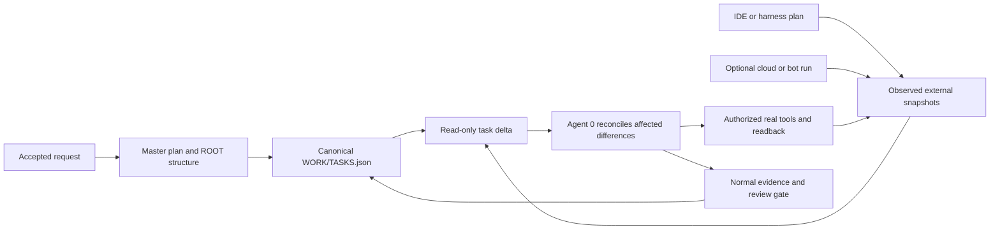

# SX-MILESTONE: plans, task deltas, and tool cards

ROOT is an optional coordination layer above the existing master plan and task
ledger. It connects accepted outcomes, request provenance, work structure, and
observed host/bot task state. It does not create another execution engine or
task-status authority. Read [SX-RULES](SX-RULES.md) for the operating contract.

The reusable template ships blank `PLAN.json` and `MIRRORS.json`. Examples below
describe an adopted project; they are not active assignments or accepted facts.

## Vocabulary that scales down as well as up

| Term | Meaning | Use it when |
| --- | --- | --- |
| Milestone | A major accepted outcome or checkpoint, declared as an `M-...` ID in `PLAN/MASTER-PLAN.md` | Several pieces of work jointly establish a meaningful result |
| Wave | A group of related phases released or coordinated together | Capacity, dependencies, or a delivery boundary needs grouping |
| Phase | A coherent stage with a task list and clear purpose | Research, implementation, integration, or verification needs its own stage |
| Group | An optional collection of related items within that structure | A task list needs a useful section, component, or work package |
| Task | An independently owned and accepted unit in `WORK/TASKS.json` | The work needs status, dependencies, evidence, and review |
| Subtask | A smaller plan item beneath a task | Breaking down the work makes the next action clearer; give it a canonical task ID if independently owned or accepted |
| Single action | A bounded operation within an assignment, represented by an `action` node when useful | The operation needs explicit tool/evidence/stop boundaries; it is not a new task by default |
| RTask | The originating user or authorized harness request | The plan needs a stable pointer back to its objective and source |
| STask | A bounded delegated request with a parent RTask or STask | Another worker or channel needs a clear assignment and return boundary |
| Event | A recorded occurrence, such as a crash, bug, unknown result, or verified observation | Time, provenance, and evidence matter; use Agent X records where enabled |
| TODO | The pending state of accepted canonical work | A task is waiting to start; it is not a hierarchy level |

The recommended ordering is:

```text
accepted milestone
└── wave: related phases that can advance together
    └── phase: coherent task list
        └── group: optional itemized section
            └── task: canonical TASK-... reference
                └── subtask: optional decomposition
                    └── single action: bounded next operation
```

Skip levels that do not help. A small fix can use one request and one task.
Milestones group outcomes, waves group phases, and phases group work. This
ordering avoids defining both "waves contain phases" and "phases contain waves"
in the same template. Parallelism comes from valid dependencies, ownership,
resources, and the host's real capabilities, not from a node's name.

A display outline such as `01-01-01` is a human navigation aid. It is not a
canonical task ID or a dependency edge. Reordering a plan should not renumber
`TASK-001` or change the identity of a retained request or node.

## Counts are planning hints

The illustrative expansion of ten phases, ten waves, ten groups, ten tasks,
ten subtasks, and three actions produces **300,000 single actions**. Multiplying
counts is useful for estimating scale; generating that many empty records would
consume context and create maintenance work before a result exists.

Choose counts from the project. Define the outcome and nearest checkpoint,
create the immediately actionable tasks, then expand the next wave as evidence
resolves uncertainty. Keep future work at an appropriate level of detail.
The optional hierarchy is not a requirement to populate every level or a
promise that a model can process a fixed number of events autonomously.

## Record map and source of truth

| Location in the selected record scope | Content |
| --- | --- |
| `GLOBAL/CONTEXT.md` | Shared purpose, constraints, source hierarchy, project references |
| `PLAN/MASTER-PLAN.md` | Accepted outcome, `M-...` milestone definitions, criteria and sequencing |
| `WORK/TASKS.json` | The only task-state ledger, including acceptance and review history |
| `WORK/FOCUS.json` | Bounded current objective and selected task IDs |
| `ROOT/PLAN.json` | `schemaVersion`, `requests`, and `nodes` |
| `ROOT/MIRRORS.json` | `schemaVersion`, `bindings`, `observations`, and `cards` |
| `EVENTS/`, Agent Y records, `REVIEWS/`, `MEMORY/` | Existing event, execution, review, and checkpoint records |

Request records retain kind, title, source reference, and a parent for delegated
work. Plan nodes retain a kind, title, request association, optional parent,
and applicable milestone or canonical task references. These structural records
do not own status. An empty ROOT plan means no ROOT structure is recorded.

ROOT creates stable hash-derived `RT-...`, `ST-...`, `NODE-...`, `BIND-...`,
`OBS-...`, and `CARD-...` IDs. Use the ID returned by the command. An explicit
`--key` identifies an immutable operation: retrying the same key with the same
content reuses it; changed content needs a new key. Keys are local coordination
identities, not credentials or proof of remote execution.

Each independently accepted task still lives in the existing canonical ledger.
For planning, summarize a structural parent's unique task references rather than
counting duplicated links. Runtime `status` provides a bounded derived milestone
summary from matching canonical milestone/task references and descendant nodes.
All linked tasks being done does not automatically accept a milestone, resolve
omitted work, or prove a deployment.

## Three surfaces, explicit relationships



The diagram describes a workflow, not a background service. The ROOT CLI reads
and writes local records; authorized host tools or a future tested adapter
perform actual IDE, cloud, or bot operations.

A binding maps one named external item to one or more existing task IDs.
Several bindings may point to the same task. A single IDE item can summarize a
phase containing three tasks while a cloud worker returns separate attempts for
one of those tasks. Equal item counts are neither expected nor required.

Delta compares each external item with the aggregate of **all** its bound task
statuses. A binding covering `done` plus `in_progress` expects `running`, not
simultaneous completion and running for the same external item. Every bound
task fingerprint is checked, including members outside the selected output
slice. The report retains `coveredTaskIds`, expected external states, and any
stale task IDs so this comparison remains inspectable.

Explicit `bind --supersedes BIND-ID` corrects the same external item's mapping
or designates a replacement attempt with a new external item. It must remain in
the same channel and layer; a new item must retain the same canonical task set.
The old binding and its observations stay in history and are excluded from the
current comparison. This local bookkeeping never stops or cancels the earlier
process. Verify any previous runtime handle separately before starting a
conflicting replacement. Current binding alignment says nothing about success
of every historical attempt.

Record both the raw external state and one of ROOT's normalized states:
`pending`, `running`, `blocked`, `completed`, `cancelled`, `unknown`, or
`unavailable`. These describe the observed external item; they do not replace
the six canonical task statuses. A claimed source revision and evidence
reference accompany each observation. ROOT records actual fingerprints of the
referenced canonical records, allowing later changes to be noticed.

For this external-item projection, cancelled members are left out when other
members remain; their cancellation and history stay in the canonical ledger.
The following rules apply in order:

| Covered canonical statuses | Compatible normalized external state |
| --- | --- |
| Every member is `cancelled` | `cancelled` |
| Every remaining member is `done` or `needs_review` | `completed` |
| A remaining member is `blocked`, and another is `in_progress` | `blocked` or `running` |
| A remaining member is `blocked`, with none `in_progress` | `blocked` |
| Some work is `in_progress`, or completed/review work is mixed with pending work | `running` |
| Every remaining member is `todo` | `pending` |

This projection checks compatibility of a reported item. It does not change a
task status or turn pending review into accepted work. An external `unknown` or
`unavailable` observation remains an explicit unresolved issue.

| Observation | What can be concluded | What remains to resolve |
| --- | --- | --- |
| Harness running; task `in_progress`; matching observed inputs | The recorded snapshot is compatible | Whether the host still reports that state now |
| Bot completed; task `needs_review` | Execution and pending acceptance can both be accurate | Evidence review and Agent 0/user decision |
| Bot completed; task later accepted `done` | Execution and accepted task state can be compatible | A new observation may be needed after the canonical record changed |
| Harness running; binding covers `done` plus `in_progress` | The external item can match the aggregate work in progress | Fresh fingerprints for every covered task, including members outside the output selection |
| Bot cancelled; task still `todo` | One attempt may have ended while the task remains in scope | Cancellation reason and authorized next attempt or task cancellation |
| Task fingerprint changed after the snapshot | The observation describes an older canonical record | Recheck the affected source and append an observation |
| Host tool unavailable, or source revision unverified | External state is unresolved | Retain the limitation; obtain authorized access or hand off |
| No binding for relevant external work | Its relationship to canonical tasks is unknown | Inspect and bind the actual item rather than infer by list order |

The caller supplies external revisions and evidence pointers. Recording them
does not independently authenticate a provider, fetch evidence, inspect a remote
job, or guarantee the statement is true. State freshness depends on an honest
observation and the relevant current inputs. A local report cannot prove that
every parallel chat has saved its newest state.

## Commands and scope selection

Use the reviewed launcher from the directory containing `.SYSTEMX`. Initialize
in an adopted scope, inspect the preview, then apply additions:

```bash
bash .SYSTEMX/SYSTEMX.sh root init
bash .SYSTEMX/SYSTEMX.sh root init --apply
bash .SYSTEMX/SYSTEMX.sh root status
bash .SYSTEMX/SYSTEMX.sh root delta
bash .SYSTEMX/SYSTEMX.sh root delta --layer harness --layer bot
bash .SYSTEMX/SYSTEMX.sh root packet --task TASK-001
```

For a managed installation, use its verified selected defaults:

```bash
systemx run --target "/path/to/workspace" --offline -- root status
systemx projects --target "/path/to/workspace" -- root init --project Project-A
systemx projects --target "/path/to/workspace" -- root init --project Project-A --apply
systemx projects --target "/path/to/workspace" -- root delta --project Project-A
```

`--target` selects the directory containing the outer installation. The child
selector selects its `.SYSTEMXP` records; it does not install nested tools.
Initialization preserves existing files. Plan/observation mutations preview by
default and require `--apply`. Read-only inspection does not call providers.

| Command after `root` | Required arguments | Optional links or controls |
| --- | --- | --- |
| `request` | `--key`, `--kind rtask\|stask`, `--title`, `--source-ref` | `--parent RT/ST-ID` for a delegated request; `--apply` to write |
| `node` | `--key`, `--kind milestone\|wave\|phase\|group\|task\|subtask\|action`, `--title`, `--request RT/ST-ID` | `--parent NODE-ID`, `--milestone M-ID`, repeatable `--task TASK-ID`, `--apply` |
| `bind` | `--key`, `--layer harness\|bot`, `--channel`, `--item`, repeatable `--task TASK-ID` | `--supersedes BIND-ID` for a corrected mapping or replacement attempt under the constraints above; `--apply` |
| `observe` | `--key`, `--binding BIND-ID`, `--raw-state`, `--state`, `--revision`, repeatable `--evidence` | `--expected-revision REV`, `--at` with an actual timezone-aware observation time, `--apply` |
| `card` | `--key`, repeatable `--task TASK-ID`, `--provider`, `--tool`, `--purpose`, `--input-revision`, repeatable `--expected-evidence`, `--permission-boundary`, `--stop-condition` | `--request RT/ST-ID`, `--apply` |
| `delta` | None | Repeatable `--task TASK-ID`, repeatable `--layer harness\|bot`, `--limit`, optional `--max-age-seconds N` |
| `packet` | None | Repeatable `--task TASK-ID`; `--limit` from one through ten |
| `status` | None | Summary of recorded ROOT structure and observations |

Use `root --help` and the selected subcommand's `--help` for the exact current
arguments, validation limits, and tool-card options. Use `task-add`, `task-set`,
and `focus` for canonical work; a ROOT command does not execute those transitions.
Run `validate` after reviewed record changes or a resolved merge.

Delta assesses `harness` by default. Select `--layer harness --layer bot` when
the project actually uses both; omitted layers are explicitly unassessed.
An optional bot need not exist for a harness-only workflow. The report defaults
to ten selected tasks, supports a bounded limit up to 100, and reports coverage
and omitted counts. A clear report for that selection is not an assessment of
every task, unbound external item, or undiscovered channel.

`packet` supplies selected ROOT context for up to ten existing tasks, capped at
64 KiB. Use it to load the relevant slice instead of rereading all rules, plan
nodes, mirrors, and review history every turn. Inspect the underlying task and
evidence when the bounded packet reports omitted or truncated material.

Without an explicit expected source revision, a delta cannot establish that an
observed revision is the intended one and reports that limitation. Both revision
strings are caller-supplied; equal strings are not a remote authenticity check.
By default, task changes and supplied revision differences drive freshness.
Choose an age limit only when the task needs one. An age warning does not create
a polling schedule or automatically authorize another readback.

## Tool-card contract

A tool card is a bounded declaration for one operation. It connects the accepted
request and task IDs to an actual tool available in the current host. It is not
a universal tool name or a provider-specific invocation copied into every model.

| Card element | What to record |
| --- | --- |
| Scope and identity | Selected `.SYSTEMX` or named `.SYSTEMXP`, request ID, existing TASK IDs, and card identity |
| Capability and tool | Intended capability, actual discovered tool name, and the current accepted input schema or reviewed schema reference |
| Inputs and revision | The minimum reviewed parameters/context, the observed source revision, and relevant canonical inputs |
| Effect and authority | Read-only or proposed change, expected boundary, and applicable existing user/host permissions |
| Evidence | The result/receipt/readback needed to support a claim and where it will be retained |
| Stop and return | A finite stop condition, failure boundary, next action, and return to the coordinator |

The CLI card retains a compact summary through the options above; detailed
parameters or a schema reference can live in the reviewed task packet or the
card's purpose/evidence references. It does not retain a universal executable
payload or invoke a tool. Resolve and validate actual tool inputs in the host
immediately before the authorized call.

For example, a card can request a focused test of an already assigned web-app
route using the actual terminal tool in that session. Its reviewed inputs name
the repository revision, test command, allowed work, timeout or host limit,
evidence path, and the condition for returning a failure. Another card can
request a host-plan update using its discovered plan tool and native schema.
Never invent a callable name because a diagram contains a box for that role.

VS Code's language-model extension tools declare a name and input schema and
provide a host implementation; availability and invocation belong to that host.
See the [official VS Code tool API](https://code.visualstudio.com/api/extension-guides/ai/tools).
MCP separately defines tool discovery and calls through `tools/list` and
`tools/call`; a template card is not a running MCP implementation. See the
[versioned MCP tools specification](https://modelcontextprotocol.io/specification/2025-06-18/server/tools).
These are interoperability references, not dependencies installed by ROOT.

## Worked example: research A/B and a 20-page web application

This example shows how a large request can remain finite and traceable. The
numbers illustrate an approach; the project decides its own outcomes and scope.
Do not create the example's tasks in the reusable public template.

**1. Establish the brief and end condition.** The owner asks for a 20-page web
application and research comparing approaches A and B. Agent 0 records an RTask
source reference, confirms which pages and user journeys count, and agrees on
the required evidence. Research depth, accessibility targets, budget, data
handling, deployment authority, and exclusions belong in the brief and master
plan. A deep research prompt helps when it supplies relevant, trustworthy
constraints and sources; volume alone does not improve evidence quality.

**2. Define accepted checkpoints.** In `PLAN/MASTER-PLAN.md`, declare, for
example, `M-001` for an accepted A/B decision and architecture, `M-002` for
implemented journeys, and `M-003` for accepted verification and delivery.
Criteria distinguish local behavior from any authorized deployment and live
readback. ROOT milestone nodes reference those existing IDs.

**3. Expand the nearest wave.** Wave 1 groups research phases for A, B, and their
comparison. Wave 2 can later group implementation phases by shared foundation
and related page journeys. Wave 3 can group integration, verification, and
handoff phases. A 20-page app need not create 20 identical worker assignments;
shared routing, data, components, and risk determine useful boundaries.

**4. Create concrete tasks.** Record existing tasks such as `TASK-001` for A,
`TASK-002` for B, and `TASK-003` for the comparison decision, with the comparison
depending on accepted research results. The root of each task is still the
canonical ledger. ROOT phase/group nodes link the appropriate task IDs.
Shared research goes through approved sources; a reference URL does not grant
permission to copy private documents or upload their contents.

**5. Delegate only the useful independent work.** Agent 0 can create an STask
for each bounded research assignment and use actual native subagents or an
explicit Agent Y CLI lane. Give each worker an owner, scope, accepted questions,
source expectations, revision, evidence destination, and stop condition.
Dependency-ready work and available resources determine concurrency. Agent Alpha
can return the selected `Research.MD`, `Brand.MD`, or `Tokens.MD` reference when
needed; it does not load every AUTOBOT or become a second coordinator of the plan.

**6. Bind external items.** The IDE might have one item titled "Compare A/B"
bound to all three research task IDs. A cloud bot's research-A run may bind only
to `TASK-001`, and a later authorized retry gets its own external-item identity.
Record observations from real tools with the raw state, normalized state,
revision, time, and evidence. No list-position matching is required.

**7. Reconcile the delta.** Suppose the harness says "complete", A has passed
review, B is `needs_review`, and the comparison is `todo`. The task states are
not equivalent to a completed phase. Agent 0 inspects the worker results,
corrects the external plan using its actual tool if justified, and records its
readback. Agent Z can review the decision's decisive claims and checks using
the project's versioned fixed policy. Agent 0/user accepts the applicable tasks;
the A/B milestone still needs its outcome decision recorded.

**8. Expand implementation after the decision.** Populate the next useful
phases for foundation, navigation, page groups, integrations, and tests. An
independent implementation slice gets a canonical task. A small sequence such
as inspect route, edit component, run focused check can remain actions under
that task. The 20-page count is a scope requirement, not proof of usability or
a requirement for a 20-worker swarm.

**9. Retain failures and time.** A failed test or crashed provider becomes linked
Agent X evidence. Diagnose the cause and authorize only the required repair or
retry. Keep the failed attempt and relevant revisions. An unrelated cloud run
continuing after a local timeout must be accounted for before replacing it.
No event automatically reopens every completed task or starts a review loop.

**10. Accept and deliver the correct boundary.** At `needs_review`, retain
focused behavior evidence and any appropriate Agent Z scorecard. An Agent Y
draft PR is a delivery candidate. Agent 0 handles integration and acceptance;
PR close, merge, remote checks, and branch cleanup follow the separate existing
gates. If deployment is authorized, record deployed revision and observed live
behavior separately from source and local-test claims. Check the milestone
criteria, refresh affected mirror observations, then provide the handoff and
remaining operational ownership.

## Stable-ID delta example

The following is a conceptual snapshot, not an exact CLI output schema:

| Surface or record | Identity | Recorded relationship or observation |
| --- | --- | --- |
| SYSTEMX task | `TASK-001` | Research A accepted `done`, revisioned evidence retained |
| SYSTEMX task | `TASK-002` | Research B `needs_review` |
| SYSTEMX task | `TASK-003` | Compare A/B `todo`, depends on accepted research |
| Harness item | `plan-item-compare` | Bound to all three tasks; raw "complete" |
| Bot item | `research-b-attempt-1` | Bound to `TASK-002`; observed `completed` |
| Delta decision | Affected bindings and TASK IDs | Bot completion can support pending review; harness item overstates phase completion |

After a justified task transition, an older observation's task fingerprint may
be stale even when its external state remains compatible. Obtain a relevant
readback and append a new observation; do not erase history or change a source
revision to make a report look current. Unavailable surfaces remain explicitly
unverified. A clean local comparison describes recorded agreement, not verified
continuous synchronization across every worker and chat.

## Resume and completion checklist

Before a handoff, retain the accepted objective, scope, stable IDs, current
revisions, decisive evidence, failed attempts, outstanding runtime handles,
blockers, mirror differences, and exact next action. Stop requests prevent new
execution until authorized continuation. Resume from that boundary and refresh
volatile facts instead of rebuilding the same plan.

At a milestone, inspect the accepted outcome and evidence rather than simply
counting finished tasks. Reuse unchanged review evidence; evaluate affected
claims when relevant inputs change. At final delivery, distinguish source,
local execution, deployment, live observations, and owner acceptance. The
[one-shot project guide](https://github.com/WayneTechLab/dotSYSTEMX/blob/main/.SYSTEMX/docs/ONE-SHOT-PROJECT.md),
[shared-workspace guide](https://github.com/WayneTechLab/dotSYSTEMX/blob/main/.SYSTEMX/docs/SHARED-WORKSPACES.md), and
[evidence guide](https://github.com/WayneTechLab/dotSYSTEMX/blob/main/.SYSTEMX/docs/EVIDENCE.md) extend this workflow without changing the
canonical task gate.
