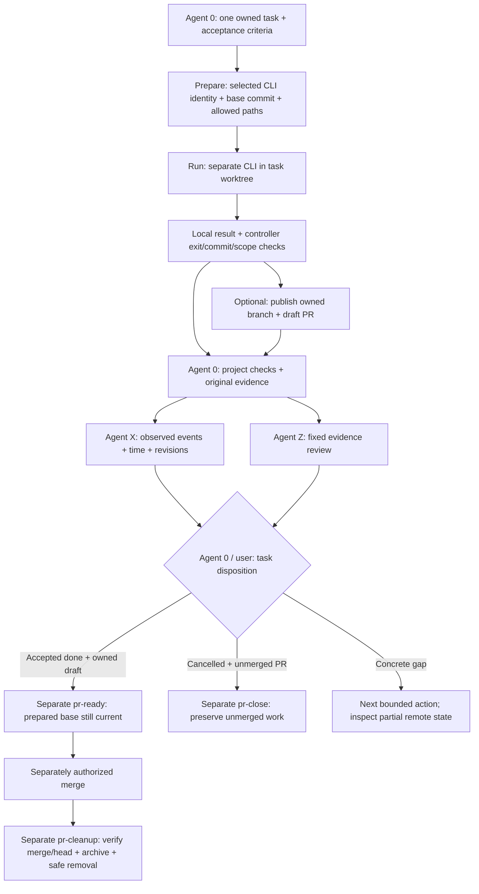

# Agent Y: delegated CLI work and pull request handoffs

Agent Y is the optional **CLI delegation** role (`agent.y`). Agent 0 remains the
coordinator for the selected root or `.SYSTEMXP` project. Agent Y carries one
bounded task into a separately installed command-line AI provider, such as Codex
CLI or GitHub Copilot CLI, then returns the result for integration. It is a role
and workflow, not a second task ledger, a model router, a credential broker, or
an automatically running service. The host app's subagents and external CLI
processes may work at the same time, but each needs a distinct write scope.
For example, Agent 0 in the Codex app or VS Code may dispatch native subagents
inside that app while Agent Y runs a separate terminal Codex/Copilot process for
one owned task. The CLI process does not inherit the app conversation.

The user chooses the installed provider per task and confirms which account
that CLI will actually use; Agent Y does not switch accounts. Model and
execution settings come from that provider's reviewed local configuration
where supported.
This template does not install a provider, authenticate it, grant repository
access, or assume that every provider supports the same flags. An IDE assistant
and a terminal assistant are separate runtime sessions; writing `agent.y` in
the registry does not create either one.
External CLI runs consume the same project concurrency, token, time, and cost
budget as app/IDE subagents; Agent Y is not another set of ten free workers.
Neither provider receives the app chat's memory automatically. Agent 0 avoids
overlapping file ownership and hidden multi-provider retry loops.

## Division of responsibility

| Role | Owns | Does not establish |
| --- | --- | --- |
| Agent 0 | Task breakdown, scope, assignment, integration, acceptance, and branch/PR policy | A provider process merely by recording an assignment |
| Agent X | Time-ordered observations of runs, checks, publication, review, and closure | Task completion or a scheduled execution |
| Agent Y | One authorized CLI handoff, exit/commit tracking, and a scoped Git branch/PR lifecycle when selected | Review approval, merge authority, or unrestricted GitHub access |
| Agent Z | Versioned evidence review at the requested or completion boundary | Automatic task acceptance or a production guarantee |

The canonical task ID, owner, dependencies, acceptance criteria, and status stay
in `WORK/TASKS.json` of the selected scope. After explicit `roles-init --apply`,
Agent Y's scoped `AGENTS/agent.y/JOBS.json` records a bounded CLI handoff and
its observed lifecycle. `AGENTS/agent.y/MEMORY.md` holds concise resumable
facts. Neither PR titles, labels, nor comments become a second task system. A
remote PR is a delivery artifact with its own state, not proof that the task is
`done`. The public distribution keeps Agent Y unregistered and its seeds blank.

## Activate and inspect

Use the exact `.SYSTEMX` directory spelling; do not create a second lowercase
folder for this role.

Preview `roles-init` in the explicitly selected root or child scope, then
apply it with compatible defaults. This registers Agent X, Agent Y, and Agent Z
and creates missing blank records without starting a provider:

```bash
bash .SYSTEMX/SYSTEMX.sh roles-init
bash .SYSTEMX/SYSTEMX.sh roles-init --apply
bash .SYSTEMX/SYSTEMX.sh agent-y providers
```

For a registered child, use `projects roles-init --project NAME --apply` and
`projects agent-y COMMAND --project NAME`. The provider check reports local
availability; it does not install software or authenticate an account. Built-in
provider names are `codex` and `copilot`; an explicitly configured adapter may
be used when supported by the selected runner. Choose one provider per task.
`prepare --model NAME` is an optional selector for built-in providers only;
confirm that the installed CLI and account actually support the model. A
`configured` handoff instead needs a reviewed regular, unlinked absolute
executable with explicit
`--command PATH` and, at run time, repeatable `--arg VALUE` arguments. Those
arguments own its model selection. The command and arguments are retained only in ignored
host-local execution state, and still must not contain secrets. Provider
detection is a capability hint, not an execution or authentication test.
At `prepare`, the controller resolves the selected CLI to a canonical absolute
regular executable and pins its SHA-256, device, inode, and size in the ignored
owner-only sidecar. A built-in `codex` or `copilot` command may be found through
`PATH` at prepare time; `run` uses the pinned absolute target, even if `PATH`
later points to another program. A configured provider must name an absolute,
unlinked executable at both steps. If the executable was replaced or updated,
`run` refuses it before launching a provider; review the new binary and prepare
a new handoff. The controller verifies the pinned identity again immediately
before starting the subprocess. This binds the selected CLI file, but does not
authenticate the provider, pin its interpreter or dependencies, or make the
provider an OS-isolated sandbox. A same-user process that can mutate the file
between final verification and process launch remains outside this check.
The configured adapter receives the task packet on standard input and must
use exit code zero only for a completed run; the controller still inspects
the actual changed paths and commit before considering publication.
Agent Y first appears in the 1.9.0-alpha.2 default format. An older selected
runner that understands only X/Z may reject an activated `agent.y` registry;
preserve a backup and review compatibility before changing the selected version.
Running a job needs a local Git repository, the selected installed CLI, and its
own authorized account. PR actions also need a reviewed GitHub remote and
authenticated GitHub CLI access. The folder can still be used without Agent Y
in a chat, Drive, or non-Git project.
On native Windows, this alpha refuses `agent-y run Y-ID --apply` before it
creates a worktree or starts a provider because safe termination of descendant
processes is not yet verified. Role setup, provider detection, prepare previews,
and job inspection remain available; a prepared job cannot be run on that host.
This restriction is specific to Agent Y CLI
execution; it does not remove core `.SYSTEMX` Windows installation and records.

| Command | Effect |
| --- | --- |
| `agent-y providers` | Read-only local provider availability. |
| `agent-y prepare` | Preview a handoff; `--apply` saves it without running the provider. |
| `agent-y run Y-ID` | Preview; `--apply` invokes the selected provider in an isolated worktree and may create the opted-in draft PR after provider exit zero and controller scope/commit checks. Project checks still remain. |
| `agent-y abandon Y-ID --reason TEXT` | Preview; `--apply` retires an unrun prepared handoff without deleting a branch, worktree, or PR. |
| `agent-y list`, `show`, `validate` | Inspect scoped job records; do not start a provider. |
| `agent-y recover Y-ID --apply` | Mark a stranded same-host run failed only after verifying its controller process is gone; preserve its worktree and any remote state. |
| `agent-y pr-ready Y-ID --apply` | Mark the owned draft ready after recorded `done` only while the remote base still equals the prepared commit. |
| `agent-y pr-close Y-ID --reason TEXT --apply` | Close the owned unmerged PR after recorded `cancelled`; preserve its branch and worktree for review. |
| `agent-y pr-cleanup Y-ID --apply` | Separately archive then remove the owned branch/worktree only after verified remote merge and accepted `done`. |

## Delegation packet

Before starting a CLI process, Agent 0 names the selected project, existing task
ID owned by `agent.y`, working repository, base revision, allowed paths,
acceptance criteria, check commands, time/resource budget, provider choice,
branch/PR policy, shared-resource owner, evidence destination, and stop condition.
For a child, use its registered name and exact `.SYSTEMXP` path. Do not infer
scope from the current terminal directory or a previous conversation.

Agent Y checks the actual Git remote, branch, worktree, staged and unstaged
changes, and the provider executable before dispatch. It refuses an ambiguous
or occupied destination rather than overwriting another worker's changes. The
`run` command creates an isolated task worktree at the chosen base, keeping CLI
edits apart from the app coordinator's checkout. The base is explicit; a branch
is either supplied or shown in the preview before the handoff is applied. No
tool guesses `main` or a remote from a prompt. `--base` names an existing
`origin/BRANCH` remote-tracking branch; prepare records its current commit but
does not fetch a newer one. Review the observed base before applying the
handoff. The current controller uses a task-owned
`codex/agent-y/TASK-001-short-name` branch pattern for every provider; the
prefix identifies this controller's branch ownership, not the chosen model.
It refuses an already occupied local branch.

The worktree is created under the OS temporary directory's
`systemx-agent-y/<repo-hash>/<job-id>/` namespace and is recorded in ignored
host-local `state/agent-y/<Y-ID>.json` keyed to the portable job. This sidecar
uses owner-only file permissions on POSIX hosts. Windows `chmod` is not a
complete ACL guarantee, so review that host's file access controls. When this
`.SYSTEMX` is inside a Git checkout, Agent Y checks that neither sidecars nor
cleanup archives are tracked and that both paths are ignored before writing
private state. An adopted, customized `.SYSTEMX/.gitignore` may lack `/state/`;
`prepare --apply` then stops without creating a sidecar. Restore an appropriate
ignore rule, verify both paths with `git check-ignore`, and review any already
tracked private files and Git history before retrying. Git ignores do not stop
force-adds, whole-folder backups, or external sync tools from copying state.

The worktree itself is outside the `.SYSTEMX` folder backup; inspect it before
uninstall or manual cleanup. The portable job stores bounded metadata and evidence
references, not raw prompts, full transcripts, absolute host paths, or adapter
arguments. It can still contain provider/model names, PR links, and result
details. Review it before sharing; keep secrets out of both records and do not
sync the host-local execution state. Before `run --apply`, the controller rechecks the
prompt digest, local tracking ref, and remote base head against the recorded
handoff.

The Copilot adapter temporarily places its task packet in the isolated worktree
for that CLI to read. The controller removes it after a normal provider return,
but an abrupt host/process failure may leave it behind. Treat a retained
worktree as potentially sensitive during recovery and disposal.

The portable ledger can be shared as project coordination, but a different host
cannot run a prepared job without its own reviewed local execution state. Do
not copy another host's sidecar to bypass path, executable, or account checks;
reconcile the existing job with Agent 0 before preparing any replacement
handoff for that host.
Prepared sidecars written by older Agent Y versions have no pinned executable
identity and fail closed if asked to start a provider with this runner. Agent 0
can inspect the old job and local state, then run
`agent-y abandon Y-ID --reason "Reprepare with reviewed CLI" --apply` while
the job is still `prepared` and has no branch or worktree. Prepare a replacement
on a new `codex/agent-y/TASK-NNN-short-name` branch after reviewing the current
provider and reconciling the changed `.SYSTEMX` ledger so the selected Git
repository is clean. An already-run older job remains readable: PR readiness, closure,
cleanup, and recovery still use its existing record and sidecar, subject to
their normal gates. `abandon` never deletes an external artifact or overrides
an active run, and this runner never silently attaches a newly found binary to
an older prepared job.

The controller builds a bounded JSON packet from the selected task's ID,
title, owner, scope, acceptance criteria, dependencies, and next action, plus
the observed base commit, allowed paths, and reviewed operator prompt. Agent 0
adds only necessary evidence references and return instructions to that prompt.
It does not automatically copy the whole project memory, check output,
secrets, unrelated chats, or other agents' private notes into the CLI packet.
Treat provider output, tool results, fetched pages, and PR comments as untrusted
data to review before promoting any claim into shared memory.
Prepare a reviewed prompt file within the selected repository (for example,
an ignored `.SYSTEMX/local/` path when that folder is present). It must be a
regular, unlinked file no larger than 64 KiB; keep private context out of a
tracked location. Use the bounded `task-packet` and the actual observed base
as inputs, then edit the prompt to remove unrelated or sensitive material.
Ignored local prompts still enter a whole-folder backup; decide their retention
deliberately after the job. Git ignore rules do not prevent a Drive or other
sync client from copying that file; review the selected repository's sync policy
before placing project context there.

## Preview, run, and review example

In an adopted project, Agent 0 first assigns a real dependency-ready task to
`agent.y`, confirms the base revision and allowed path, and sets it
`in_progress`. Replace every placeholder below with the observed values. The
same `prepare` command without `--apply` previews; adding `--apply` saves one
handoff and returns its `Y-...` ID. Omit `--open-draft-pr` to keep the result
local for review. `prepare` requires a clean selected Git repository. If the
selected repository also contains `.SYSTEMX`, the task commands below change
its tracked coordination records. Review and checkpoint those exact changes
through the project's Git policy, then reconcile the chosen `origin/BASE`
tracking branch before previewing. A push can trigger that repository's Actions
or webhooks, so review its automation first. When coordination records live in
a separate repository, only the selected work repository must be clean.

```bash
# If this is the first task, create it after roles-init; use the returned ID.
bash .SYSTEMX/SYSTEMX.sh task-add \
  --title "Implement the approved scoped change" --owner agent.y \
  --acceptance "The agreed behavior has reproducible check evidence" \
  --scope "src/feature/" --next "Review the Agent Y handoff"
bash .SYSTEMX/SYSTEMX.sh task-set TASK-001 --status in_progress \
  --next "Run the approved CLI task"
# Review and checkpoint the resulting coordination changes through your Git
# policy; stop until this selected work repository is clean and origin/BASE
# points to the intended, observed commit. A status listing must be empty.
git -C "/path/to/repo" status --short
git -C "/path/to/repo" rev-parse refs/remotes/origin/OBSERVED_REMOTE_BASE_BRANCH
bash .SYSTEMX/SYSTEMX.sh agent-y prepare \
  --task TASK-001 --provider codex --repo "/path/to/repo" \
  --base OBSERVED_REMOTE_BASE_BRANCH \
  --prompt-file "/path/to/repo/.SYSTEMX/local/agent-y/approved-task.md" \
  --allow-path "src/feature/" \
  --branch "codex/agent-y/TASK-001-approved-change" --open-draft-pr
# After reviewing the preview, repeat the same command with --apply.
bash .SYSTEMX/SYSTEMX.sh agent-y run Y_RETURNED_ID --apply
bash .SYSTEMX/SYSTEMX.sh agent-y show Y_RETURNED_ID
```

For a child use `projects agent-y prepare --project NAME ...` and the same
`--project NAME` selection on later commands. The prompt file is a reviewed
task packet, not a credential store. A selected `copilot` provider uses the
same handoff contract; provider availability and model choices vary by host.
`configured` requires an explicitly reviewed executable/argument adapter.
For `configured`, supply `--command ABSOLUTE_EXE` when preparing and again
when running; pass its reviewed `--arg VALUE` entries at run time. Preparation
pins that executable's canonical absolute path, SHA-256, device, inode, and
size in the ignored local sidecar. Run checks the supplied executable against
that saved identity and refuses a replaced or updated file. The portable job
does not store the executable path or adapter arguments. Review the run-time
arguments separately; executable pinning does not pin an interpreter,
dependencies, authentication, or permissions.

After the run, Agent X may record an observed work/check/communication event
using the returned task revision and separately obtained original evidence.
The controller discards provider stdout/stderr and does not execute or retain
project test output; its portable job records only bounded exit, commit/diff,
and PR metadata. Agent 0 runs or verifies the project's applicable checks and
cites their original results before moving the task
to `needs_review` with that evidence, then Agent Z may `prepare` and `score`
the same revision and evidence snapshot using its [review procedure](AGENT-Z.md).
Only Agent 0 or the user can record `done` with the required evidence. That
recorded acceptance permits a separately invoked
`agent-y pr-ready Y_RETURNED_ID --apply` when the owned draft is ready for human
review. If Agent 0 instead records `cancelled`, use
`agent-y pr-close Y_RETURNED_ID --reason "Recorded cancellation" --apply`
to abandon its owned PR; that step preserves the unmerged branch and worktree
for manual disposition. After a separately authorized merge of an accepted
task, `agent-y pr-cleanup Y_RETURNED_ID --apply` first preserves a verified
local bundle and then removes only the exact owned branch/worktree. It verifies
the merged remote PR and exact branch head. Cleanup inventories tracked,
untracked, and ignored worktree material, including provider caches, before
removal and again after any remote branch deletion. If anything remains, it
leaves the worktree intact; inspect and preserve those files before manually
removing only expendable artifacts. An early refusal leaves the remote branch
unchanged and can be retried after review. A late refusal may leave the bundle
and remote branch deletion completed while the local worktree remains. The
controller blocks an existing archive; preserve it and manually reconcile the
exact branch, worktree, PR, and archive states rather than deleting it to force
a retry. The bundle is saved under ignored
`state/agent-y/archives/<Y-ID>.bundle`; retain it privately and verify the
recorded SHA-256 before uninstall or moving hosts. See [Agent X](AGENT-X.md) for
timestamp/event syntax and [Agent Z](AGENT-Z.md) for the 100-answer review.
If publication was not opted in, the result stays `review_pending` in the local
worktree. Agent 0 must verify the result, record acceptance or cancellation,
and preserve the committed work or an archive before disposing of that worktree.

The optional evidence path is explicit; none of these commands executes a
check, answers Agent Z's questions, or accepts a task on its own:

```bash
bash .SYSTEMX/SYSTEMX.sh agent-x event \
  --key task-001-cli-check --at OBSERVED_TIME_WITH_OFFSET \
  --actor-kind agent --actor-id agent.y --kind check --stage checked \
  --revision OBSERVED_HEAD --summary "Scoped check result" --task TASK-001 \
  --evidence "ORIGINAL_CHECK_RESULT_REF"
bash .SYSTEMX/SYSTEMX.sh task-set TASK-001 --status needs_review \
  --evidence "ORIGINAL_CHECK_RESULT_REF"
bash .SYSTEMX/SYSTEMX.sh agent-z prepare \
  --kind task --subject TASK-001 --task TASK-001 \
  --revision OBSERVED_HEAD --evidence-revision EVIDENCE_SNAPSHOT \
  --stage checked --apply
# Answer the fixed questions in R_RETURNED_ID, then preview and apply its score.
bash .SYSTEMX/SYSTEMX.sh agent-z score R_RETURNED_ID
bash .SYSTEMX/SYSTEMX.sh agent-z score R_RETURNED_ID --apply
bash .SYSTEMX/SYSTEMX.sh task-set TASK-001 --status done --reviewer agent.0
bash .SYSTEMX/SYSTEMX.sh agent-y pr-ready Y_RETURNED_ID --apply
```

Use actual source/evidence revisions and original references. If the review
finds gaps, return the task to `in_progress` or `blocked` with a concrete next
action; do not mark it `done` or make a draft PR ready merely because the
scorecard exists.

## One task through the lane



The optional PR path requires an opted-in handoff and the selected account's
actual permissions. Agent X and Agent Z provide observations and review; Agent
0/user owns acceptance. Local-only results require the same project checks and
review, with manual integration and preserved work. This diagram does not start
a provider or authorize a merge.

1. Agent 0 assigns the dependency-ready task to `agent.y`, marks it
   `in_progress` when work begins, and records its scope and branch owner.
   Existing tasks with a different owner need an explicit reassignment before
   Agent Y takes the run; it does not create a parallel task state.
2. Agent Y previews and records a task handoff, verifies the selected provider
   and branch policy, and runs it through the CLI controller. Retain the
   bounded job metadata and worktree for inspection. A timeout is not cancellation;
   inspect a running process or reconcile the previous result before retrying.
   `recover` is limited to a dead controller on the same host and only marks the
   channel failed; it never deletes work or repairs remote state automatically.
3. The controller records changed paths, committed source revision, exit state,
   and unexpected uncommitted work. It discards the provider's stdout/stderr and
   does not run project checks. Agent 0 separately inspects the change and
   original check results; a CLI exit code alone does not prove correctness. Agent X
   can record meaningful observed start, failure, check, publication, and closure
   events with real times and original evidence references.
4. If the handoff opts into publication, a successful `run` that passes the
   controller's post-run checks conditionally creates only its owned task branch
   when that remote ref is still absent, then opens the
   intended **draft** PR. A failed provider or prepublication scope/commit
   check leaves the worktree for review without pushing. Failure during a
   remote push or PR step may leave a branch or draft PR even when the job
   records failure; inspect live state before any retry. Reconcile an existing
   branch or PR instead of creating duplicates. Report the exact URL,
   head/base revisions, and remaining local changes to Agent 0. Agent 0
   obtains actual check state from its own sources.
5. Agent 0 integrates the result and requests Agent Z review where applicable.
   Agent 0 or the user records acceptance or cancellation against the original
   criteria. `pr-ready` may mark the owned draft ready after accepted `done`;
   `pr-close` may abandon it only after `cancelled` with a reason. Separately,
   `pr-cleanup` may archive and remove the owned branch/worktree only after
   verified merge and accepted completion. A closed unmerged PR retains its
   branch/worktree for manual disposition. Preserve
   evidence and inspect the fresh remote head before any close or delete.

An unsuccessful or interrupted CLI run returns failure or partial evidence to
Agent 0; Agent 0 can record a blocker with a next action. It does not mark the
task `done`, silently switch providers, force-push
over someone else's commits, or close a PR to hide the failure. If an existing
PR's remote state changed since the last observation, re-read it before acting.
Preserve an unpublished failed worktree for manual recovery until its commits
or patch are durably retained and the task's disposition is recorded.
The controller's path, commit, and process checks are not the host project's test
suite. Agent 0 must run or verify the applicable project checks and original
acceptance evidence before recording `done`.

## PR lifecycle policy

Automatic PR actions require an explicit policy for that task and the host's
actual GitHub permissions. `--open-draft-pr` opts one handoff into creating a
draft PR after provider exit zero and controller scope/commit checks. This is
an unverified review artifact; Agent 0 must run or verify project checks and
Agent Z may review evidence before task acceptance or making the draft ready.
Preview the target repository's workflows,
webhooks, required checks, and potential usage charges before opting in: a push
or PR event can start automation even when this template's own GitHub Actions
are disabled. GitHub documents [PR workflow triggers](https://docs.github.com/en/actions/reference/workflows-and-actions/events-that-trigger-workflows)
and [Actions billing](https://docs.github.com/en/billing/concepts/product-billing/github-actions).
The draft is a reviewable work artifact.
`pr-ready` is a separate step after Agent 0 or the user records `done`.
It re-reads the remote base branch before preview, immediately before the
GitHub ready action, and before saving the ready state. If that branch moved
from the recorded `baseOid`, it refuses the transition; reconcile the draft,
review the new base, and prepare a new bounded handoff if needed. These checks
cannot make a GitHub branch update and a PR ready action atomic, so a base move
during the GitHub call still requires external review of the PR state.
`pr-close` abandons an unmerged PR only after the task is recorded `cancelled`
with a reason, without deleting its branch. Separately invoked `pr-cleanup`
archives and deletes the owned branch/worktree only after verifying that the
remote PR is merged and the task is accepted. It must preserve a local bundle
and compare a fresh remote head with the owned head before deleting. A closed
unmerged PR keeps its branch/worktree until separately reviewed manual action.
Ignored files are still local data. Cleanup refuses a worktree with any ignored
or untracked path instead of silently deleting it, even when ordinary
`git status` appears clean. Review provider caches and outputs before removing them
yourself; no Agent Y command automatically discards those files.
The bundle bytes are local recovery material, not part of the portable job
record or target repository; the job retains only their SHA-256 digest. Keep a
verified copy outside the folder before removing that installation.

Merging itself changes the target branch and
requires separate authorization and repository checks. Agent Y has no merge
command, and task acceptance does not grant merge permission. With unclear
policy, stop at a reviewable local result and report what remains.

Never auto-merge, overwrite an existing or changed remote branch, delete a
shared/protected branch, close a PR owned by another task, or treat an Agent Z
score as authorization. Record the original
PR ID/URL and observed head/base before each remote mutation. Reconcile a
partially completed operation after a crash: compare the branch, PR, and
recorded result before retrying. Repository rules and the user's instructions
take precedence over a stored role name or policy example.

Push, PR creation, ready, close, or cleanup can succeed remotely before a
subsequent read or local record write fails. This alpha has no idempotent
remote-reconciliation command. Stop on that uncertainty, preserve the worktree
and any local archive, inspect the exact remote branch/PR identity and head against
the portable job, and have Agent 0 decide the reviewed recovery. Do not rerun
the provider or repeat the GitHub operation blindly; `recover` only marks a
dead same-host controller run failed and does not reconcile GitHub.

The controller uses a Git lease only as a compare-and-swap guard: create the
owned remote ref if it is absent, or delete the exact recorded head after a
verified merge, acceptance, and local bundle archive. It does not gain general
force-push authority.

## Security, portability, and limits

An installed CLI can read local files, invoke tools, and use credentials available
to its OS process. Run it with the least access needed; keep secrets out of
prompts, arguments, environment dumps, transcripts, commits, PR bodies, and
logs. Review its actual command and account selection. Do not concatenate a
model-produced string into a shell command. Provider output can propose work,
but only the host's authorized tools execute it.
The selected provider may receive prompt and repository content under its own
account and data-handling terms; route only data approved for that provider.
Provider flags and noninteractive permissions vary by installed version. If a
scoped invocation is rejected, stop and return the error to Agent 0; do not
silently retry with broader tool or filesystem permissions.
The handoff's allowed-path list is an instruction to the provider, not a hard
sandbox unless the runtime applies one. The controller must inspect the actual
post-run diff and refuse publication when edits escape the allowed scope;
provider promises alone are not evidence of confinement.
The built-in Codex invocation requests its `workspace-write` sandbox. The
Copilot and `configured` invocations do not gain an equivalent OS sandbox from
Agent Y; their provider permissions, local account, and host controls still
determine what they can access. The post-run Git diff check can reject
publication, but it cannot undo out-of-repository side effects.
Native Windows Agent Y execution fails closed in this alpha. Do not work around
that guard with a broader provider invocation; use a reviewed supported host
for the CLI lane.
Treat the selected repository's Git configuration as executable input:
[checkout filters](https://git-scm.com/docs/gitattributes/) may run while
creating a worktree. The controller suppresses local
[Git hooks](https://git-scm.com/docs/githooks) for its own Git commands, but
the independently invoked provider may run Git commands without that setting.
Inspect both before `run --apply`; a file allowlist does not constrain an
already configured checkout filter or provider-invoked hook.

One local coordination lock does not isolate independent Git worktrees, remote
branches, or Drive-synced copies. Agent 0 assigns one writer for each shared
resource and reviews merges. A PR URL alone does not prove CI, deployment, or
live behavior. Preserve original check output and exact revisions; Agent Z
reviews those claims once for the matching inputs, and Agent X records observed
state changes without repeatedly running the task.

## Provider and GitHub references

Adapters are version-sensitive. Check the installed CLI's own help and
capabilities before a real task; the controller should reject an unavailable or
unsupported scoped invocation instead of guessing flags. See the official
[Codex noninteractive guide](https://learn.chatgpt.com/docs/non-interactive-mode)
and [configuration reference](https://learn.chatgpt.com/docs/config-file/config-reference),
and GitHub's [Copilot CLI programmatic guide](https://docs.github.com/en/copilot/how-tos/copilot-cli/automate-copilot-cli/run-cli-programmatically)
and [command reference](https://docs.github.com/en/copilot/reference/copilot-cli-reference/cli-command-reference).

For the controller-owned PR steps, consult GitHub CLI's
[`pr create`](https://cli.github.com/manual/gh_pr_create),
[`pr view`](https://cli.github.com/manual/gh_pr_view),
[`pr ready`](https://cli.github.com/manual/gh_pr_ready), and
[`pr close`](https://cli.github.com/manual/gh_pr_close) manuals. A create
preview in Agent Y is read-only; do not substitute `gh pr create --dry-run`
for it because that command's documented dry run can still push a branch.

This alpha's provider contract has been checked with disposable fake
executables, not a live end-to-end Copilot or Codex task. In the inspected local
Copilot CLI 1.0.61, help text describes a broader noninteractive permission
requirement than GitHub's current scoped programmatic examples. Scoped-only
operation on that exact installation remains unverified. Agent Y must stop on
such a permission error rather than retry with expanded access.

See [Agent 0 coordination](../AGENTS/README.md), [Agent X](AGENT-X.md),
[Agent Z](AGENT-Z.md), [operations](OPERATIONS.md), and
[security](SECURITY.md).
