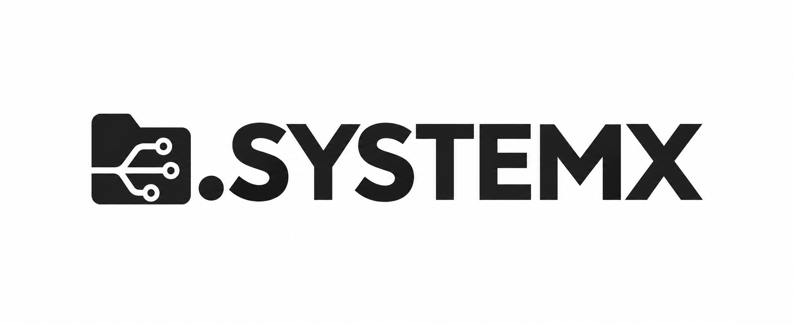
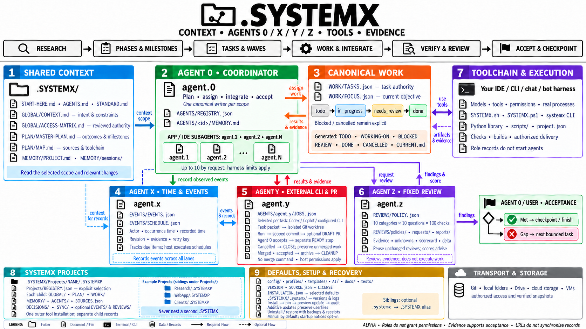
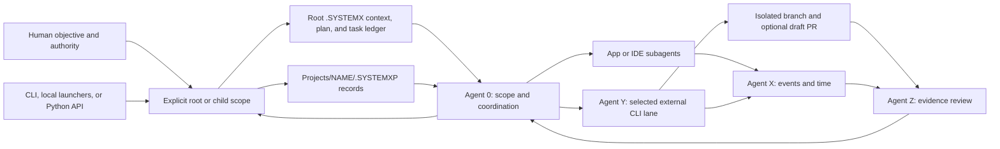

# .SYSTEMX



**DOT SYSTEMX is portable project memory and coordination for work with AI assistants.**
It keeps the objective, plan, tasks, evidence, and next step in a reviewable folder
that people and their tools can carry across sessions. The canonical folder name
is exactly **`.SYSTEMX`**.

A product of **Wayne Tech Lab LLC**, created by **Lucas (SatoshiUNO)**.
[Portfolio: Networks.Chat](https://Networks.Chat) ·
[Business: WayneTechLab.com](https://WayneTechLab.com)

[Use this template](https://github.com/WayneTechLab/dotSYSTEMX/generate) ·
[First-time setup](https://github.com/WayneTechLab/dotSYSTEMX/wiki/First-Time-Setup) ·
[Manual](https://github.com/WayneTechLab/dotSYSTEMX/wiki) ·
[Illustrated white paper](https://github.com/WayneTechLab/dotSYSTEMX/wiki/White-Paper)

> **ALPHA — USE AT YOUR OWN RISK.** The format may change daily and is provided
> without warranty. Review and pin a release, keep recoverable backups, and
> validate the result in your own project. Template checks do not certify an
> application or process as production ready. See the
> [release policy](https://github.com/WayneTechLab/dotSYSTEMX/wiki/Release-Policy)
> and [version history](https://github.com/WayneTechLab/dotSYSTEMX/wiki/Versions-and-Changelog).

## Quick start: add `.SYSTEMX` to a local project

Run this from the **containing project directory** on macOS or Linux. You need
Python 3.9+ and Git. The isolated Python environment lives outside the project;
the first `first-run` command previews changes before you apply them. This
example selects the reviewed `v1.10.0-alpha.2` release and leaves updates manual.

```bash
python3 -m venv "$HOME/.venvs/dotsystemx"
"$HOME/.venvs/dotsystemx/bin/python" -m pip install \
  "git+https://github.com/WayneTechLab/dotSYSTEMX.git@v1.10.0-alpha.2"
systemx() { "$HOME/.venvs/dotsystemx/bin/python" -I -B -m systemx "$@"; }

systemx first-run --target "$PWD" --profile project --version 1.10.0-alpha.2
systemx first-run --target "$PWD" --profile project --version 1.10.0-alpha.2 --apply
systemx status --target "$PWD"
systemx run --target "$PWD" --offline -- validate
```

The preview and apply commands retrieve the exact release but do not include an
independent archive digest in this short example. For a SHA-256-pinned remote
install, use the release's **codeload tag ZIP** digest with `--archive-sha256`,
obtained from a separately trusted record. The
[installation guide](https://github.com/WayneTechLab/dotSYSTEMX/wiki/Installation-and-Updates)
explains that trust boundary, verification, migration, and removal. The
[Windows PowerShell path](https://github.com/WayneTechLab/dotSYSTEMX/wiki/First-Time-Setup)
and [chat or Drive profiles](https://github.com/WayneTechLab/dotSYSTEMX/wiki/Getting-Started)
have their own setup steps. A URL alone does not grant an AI chat access to files
or make its records persist.

After installation, fill in only facts you know: `.SYSTEMX/GLOBAL/CONTEXT.md`,
`.SYSTEMX/PLAN/MASTER-PLAN.md`, and the first task in the canonical ledger.
Read `.SYSTEMX/START-HERE.md` and the
[daily workflow](https://github.com/WayneTechLab/dotSYSTEMX/wiki/Daily-Workflow)
before asking an assistant to continue the work. Validation checks the format;
it does not prove the project's build, deployment, or live behavior.

## Why I started it

I started `.SYSTEMX` to keep my local scripts and TODO folder in sync while I
worked on a project. I needed one place to see what was next, what was under way,
and what was actually done. Over the last year it grew within a larger Firebase
and Google Cloud template into a stack-neutral format for project context, a
Master Plan, task ownership, evidence, and Agent 0 coordination. The standalone
template makes those records reusable without requiring that original stack.

The long-term ambition is to keep an assistant oriented through **10,000 or more
task-based events**. That is a design goal, not a benchmark or a promise of
autonomous completion. The [founder's note](https://github.com/WayneTechLab/dotSYSTEMX/wiki/About)
and [long-running work guide](https://github.com/WayneTechLab/dotSYSTEMX/wiki/Anti-Drift-and-Long-Running-Work)
describe the origin and the practical limits.

“DOT” comes from the leading period in `.SYSTEMX`. Dot-prefixed names are
conventionally hidden in ordinary macOS/Linux listings; Windows uses a separate
hidden attribute. Hidden does not mean private, encrypted, or excluded from Git.
**Keep the dot and uppercase letters exactly.** On a case-sensitive filesystem,
`.systemx` can become a second, conflicting directory. Setup can optionally
create a lowercase compatibility link where supported; see
[exact-case setup](https://github.com/WayneTechLab/dotSYSTEMX/wiki/Exact-Case-and-Alias).

## How the system coordinates work

[](.SYSTEMX/MEDIA/Infographics/systemx-cli-projects-4k.jpg)

[Download the 4K full-system map](.SYSTEMX/MEDIA/Infographics/systemx-cli-projects-4k.jpg) ·
[Accessible text equivalent](docs/assets/systemx-full-system.md) ·
[CLI and tools guide](.SYSTEMX/docs/CLI-TOOLS.md) ·
[Media library](.SYSTEMX/MEDIA/README.md)

Use the CLI to select one outer workspace and one named project. Each
`.SYSTEMX/Projects/Project-A/.SYSTEMXP` keeps its own plan, ledger, memory, and
agent records while sharing the outer tools and version pin. The external CLI,
local shell/PowerShell launchers, Python library, app/IDE subagents, and Agent Y's
selected provider have distinct entry points; the [CLI and tools guide](.SYSTEMX/docs/CLI-TOOLS.md)
shows how they connect.



Agent Y is a separate CLI run, even when its provider shares configuration with
an app or IDE. Agent 0 passes an explicit task packet and accepts its evidence;
the folder does not grant a model, GitHub account, or worker process authority.
The selected CLI file is pinned at preparation and checked before execution;
provider authentication and host permissions still need their own review.

1. **Define and plan:** record the purpose, constraints, milestones, and acceptance
   criteria. Agent 0 turns the next part of the plan into bounded tasks.
2. **Execute and log:** a person or authorized app/IDE subagent works within scope.
   Optional Agent Y can run a per-task selected Codex, Copilot, or configured CLI
   provider in an isolated Git worktree. Agent X records meaningful actor, time,
   revision, and due-item events.
3. **Check and accept:** Agent Z can score evidence against a versioned set of 100
   questions in 10 categories. Agent 0 and the user decide whether the original
   acceptance criteria were met and what happens to the draft PR and branch.

| Responsibility | Canonical record |
| --- | --- |
| Shared context and constraints | `.SYSTEMX/GLOBAL/CONTEXT.md` |
| Reviewed access decisions and gaps | `.SYSTEMX/GLOBAL/ACCESS-MATRIX.md` |
| Outcomes and acceptance | `.SYSTEMX/PLAN/MASTER-PLAN.md` |
| Source locations, interfaces, and boundaries | `.SYSTEMX/PLAN/MAP.md` |
| Task status, ownership, dependencies, and evidence | `.SYSTEMX/WORK/TASKS.json` |
| Current focus and reviewed facts | `.SYSTEMX/WORK/FOCUS.json`, `.SYSTEMX/MEMORY/PROJECT.md` |
| Agent handoffs and checkpoints | `.SYSTEMX/AGENTS/<id>/MEMORY.md` and session records |
| Optional CLI task/PR lane, events, and reviews | `.SYSTEMX/AGENTS/agent.y/`, `.SYSTEMX/EVENTS/`, `.SYSTEMX/REVIEWS/` after role activation |
| On-demand detailed reference panel | `.SYSTEMX/AUTOBOT/` and optional Agent Alpha (`agent.a`) |
| Local temporary, large, imported, and private payloads | `.SYSTEMX/DATA/`; payloads ignored by Git by default |

The task ledger generates TODO, WORKING-ON, BLOCKED, REVIEW, DONE, and CANCELLED
views. The public template starts with blank project records and only the
`agent.0` coordinator. Role activation registers Agent X, Y, and Z records; it does
not start a worker, schedule a job, or grant permissions. The AI app, IDE, CLI,
or other harness supplies actual models and tools. See the
[access matrix and map guide](.SYSTEMX/docs/ACCESS-AND-MAP.md) for the two
optional blank records; they are navigation and reviewed intent, not live IAM
or an automatic system inventory. See the
[Agent 0](https://github.com/WayneTechLab/dotSYSTEMX/wiki/Agent-0-and-Subagents),
[Agent X](https://github.com/WayneTechLab/dotSYSTEMX/wiki/Agent-X),
[Agent Y](https://github.com/WayneTechLab/dotSYSTEMX/wiki/Agent-Y), and
[Agent Z](https://github.com/WayneTechLab/dotSYSTEMX/wiki/Agent-Z) manuals.

For multiple named projects, one outer `.SYSTEMX` can hold separate
`.SYSTEMX/Projects/<name>/.SYSTEMXP` records. Each child keeps its own context,
plan, tasks, and memory, and scoped commands require explicit project selection.
Do not nest a second `.SYSTEMX` inside `.SYSTEMX`. See
[SYSTEMX PROJECTS](https://github.com/WayneTechLab/dotSYSTEMX/wiki/SYSTEMX-Projects).

```bash
# Use the containing workspace directory as --target; preview before --apply.
systemx projects --target "/path/to/workspace" -- add Project-A --kind software
systemx projects --target "/path/to/workspace" -- add Project-A --kind software --apply
systemx projects --target "/path/to/workspace" -- context --project Project-A --agent agent.0
```

The direct `projects` command defaults to offline startup and uses the managed
workspace's verified selected defaults. The compatible `systemx run --target
PATH --offline -- projects ...` form and reviewed folder-only launchers remain
available. Source URLs do not connect cloud services or synchronize records.

## Detailed project context on demand

[AUTOBOT](.SYSTEMX/docs/AUTOBOT.md) adds an optional second tier for design,
product purpose and voice, memory, rules, research, brand, media, design tokens,
data, and archive references. Its ten named Markdown functions stay outside the
ordinary resume packet. **Agent Alpha (`AGENTA`, `agent.a`)** coordinates a
bounded selection requested by Agent 0/X/Y/Z or Tools; Agent 0 still owns the plan
and acceptance. Files such as `Design.MD`, `Soul.MD`, `Brand.MD`, and `Tokens.MD`
can describe the company's identity, ICO/favicon and logo variants, licensed
fonts, media kit, application CSS, and approved source material after adoption.

Explicit `autobot init` previews Agent Alpha activation; `--apply` adds missing
blank records. It is separate from X/Y/Z role activation. Selected context and
matching completed requests are reused until inputs change. This is reference
routing and recordkeeping, without background model calls or recurring checks.
Each named `.SYSTEMXP` may maintain its own panel with shared outer tools.

[DATA](.SYSTEMX/docs/DATA.md) supplies local `TEMP`, `LARGE`, `IMPORTS`,
`RESEARCH`, `ASSETS`, `EXPORTS`, `CACHE`, and `ARCHIVE` folders. Payloads are
**ignored by Git by default**; only the empty scaffold is intended to be tracked.
Git ignore does not remove committed files or control Drive, backups, or other
uploads. Use `data audit` to inspect the adopted checkout. Bot files keep reviewed
pointers to payloads; they do not automatically read or upload them.

## Try it with an AI assistant

Once the folder is installed, accessible, and initialized for your project, a
bounded request can start like this:

```text
Finish [TASK OR OBJECTIVE] using .SYSTEMX Agent 0 with subagents.
Read the active project's context, Master Plan, task ledger, and current focus.
Use up to 10 subagents if the harness supports them and parallel work helps.
Give each worker a bounded assignment. Record verified results and the next
step; distinguish local checks from live acceptance.
```

The ten-worker number is a requested ceiling, not a guarantee of available
capacity. The folder does not launch agents. The
[prompt cookbook](https://github.com/WayneTechLab/dotSYSTEMX/wiki/Prompt-Cookbook)
and [new-chat setup prompt](https://github.com/WayneTechLab/dotSYSTEMX/wiki/New-Chat-Setup-Prompt)
show longer examples and chat-only handoffs.

For a task that benefits from another installed CLI model, ask Agent 0 to assign
one bounded Agent Y packet with its task ID, project scope, chosen provider,
acceptance checks, and branch/PR policy. The CLI run has its own context and
history; it does not inherit the app's chat or native subagent pool. With the
opt-in PR policy, successful work opens a **draft** PR for review. Agent Z's
scorecard and Agent X's event log can inform Agent 0's acceptance decision, but
neither merges code. Marking a draft ready, merging it, abandoning it, and
removing its branch are distinct actions with explicit authority and recorded
outcomes. See the [Agent Y manual](https://github.com/WayneTechLab/dotSYSTEMX/wiki/Agent-Y)
for the task packet and safe lifecycle.
An opened PR may trigger the target repository's workflows or webhooks; review
their cost and effects before enabling this option. This template's own GitHub
Actions remain disabled.

## Work across tools and environments

The same records can live in a repository, local directory, synchronized Drive
folder, or a saved chat attachment when the user and tool have access. An outer
`.SYSTEMX` can also index multiple `.SYSTEMXP` projects. Use one canonical writer
per scope and verify saved revisions before another session writes. Cloud URLs
identify a location; they do not connect a service by themselves.

[Four use-case walkthroughs and 4K graphics](https://github.com/WayneTechLab/dotSYSTEMX/wiki/Use-Case-Infographics)
cover ChatGPT with Google Drive, Codex with a GitHub project, Dots/Codex Cloud,
and Codex/Copilot CLI with a local drive. Those retained cards show the earlier
Agent 0/X/Z baseline; their text guides and the full-system map above include
the current optional Agent Y lane. The
[media library](.SYSTEMX/MEDIA/README.md) holds the downloads and text guides.
For a researched brief that becomes phases, milestones, tasks, and review waves,
see the [one-shot project guide](https://github.com/WayneTechLab/dotSYSTEMX/wiki/One-Shot-Project-Guide).
“One shot” describes the starting brief, not a promise of completion in one
response.

## Versions, evidence, and limits

New installations pin their selected defaults version and use manual updates.
An optional startup check **reports** a newer release; it does not download or
select it. Normal updates add new versioned defaults and preserve existing
project records and earlier files. Changing a stock root launcher can require
an explicit, backed-up bootstrap refresh. Read the
[upgrade](https://github.com/WayneTechLab/dotSYSTEMX/wiki/Installation-and-Updates)
and [uninstall/restore](https://github.com/WayneTechLab/dotSYSTEMX/wiki/Uninstall-and-Cleanup)
instructions before changing an active project.

Focused handoffs may avoid rereading long chats, repeating searches, or
replanning accepted work. That can save input tokens, processing time, and
usage-based API costs in some workflows. Maintaining records and using extra
agents also costs tokens and time; no fixed savings have been measured or
guaranteed. This is a coordination and memory pattern, **not AGI or model
retraining**. [Efficiency and measurement](https://github.com/WayneTechLab/dotSYSTEMX/wiki/Tokens-Cost-and-Time)
and [evidence rules](https://github.com/WayneTechLab/dotSYSTEMX/wiki/Evidence-and-Acceptance)
explain how to test the benefit and report completion honestly.

The template does not install a Firebase app, cloud service, agent runtime, or
MCP server. It does not make an existing project production ready. The
[Technical Guide](https://github.com/WayneTechLab/dotSYSTEMX/wiki/Technical-Guide)
and [Stack Guide](https://github.com/WayneTechLab/dotSYSTEMX/wiki/Stack-Guide)
explain its current implementation and how to connect real project commands.

Agent Y's worktree, allowed-path checks, and PR gates coordinate work; they are
not an OS security sandbox. An external CLI can use credentials and files
available to its host account. For untrusted providers or prompts, isolate that
CLI under a separate OS identity or container without controller GitHub
credentials or write access to project `.SYSTEMX` records. Review the
[Agent Y security boundary](https://github.com/WayneTechLab/dotSYSTEMX/wiki/Agent-Y)
before enabling its execution lane.

## Manual, support, and attribution

The [wiki](https://github.com/WayneTechLab/dotSYSTEMX/wiki) is the manual for
setup, record formats, roles, prompts, operations, and release history. The
[illustrated white paper](https://github.com/WayneTechLab/dotSYSTEMX/wiki/White-Paper)
contains the deeper coordination diagrams and implementation discussion for its
published Agent 0/X/Z baseline. Read its
[edition 1.2 erratum](.SYSTEMX/MEDIA/White-Paper/ERRATA.md) for a corrected
release-report citation. The [Agent Y manual](https://github.com/WayneTechLab/dotSYSTEMX/wiki/Agent-Y)
documents the newer external CLI lane.

[Contributing](CONTRIBUTING.md) · [Support](SUPPORT.md) ·
[Security](SECURITY.md) · [MIT License](LICENSE)

Maintained by **[Wayne Tech Lab LLC](https://github.com/WayneTechLab)**. This
standalone template was extracted from the private `SFWA-WTL-TEMPLATE`
repository, which public readers cannot open. [Source provenance](.SYSTEMX/SOURCE.json)
records that relationship; this repository is the public standalone source.
Keep private project records out of public exports and retain the license and
attribution when redistributing the folder.

## Optional Gusto HR integration package

An optional [GUSTO package](.SYSTEMX/GUSTO/README.md) defines employer, employee, manager and
contractor page contracts, seven reference roles, provider/native capability
ownership and account-free synthetic fixtures. It records the exact Gusto React
SDK 0.56.6 endpoint inventory and preserves provider credentials outside release
files. The host builds its own UI/server adapters; this package does not deploy
HR services or submit payroll. Real demo API testing requires an approved
developer application; no shared public test key is supplied.

Read [Gusto setup and account-free testing](https://github.com/WayneTechLab/dotSYSTEMX/wiki/Gusto-HR-Integration)
or the [portable getting-started guide](.SYSTEMX/GUSTO/docs/GETTING-STARTED.md).
Validate the catalogs and synthetic fixtures without credentials:

```bash
python3 -I -B -m unittest discover -s .SYSTEMX/tests -p test_gusto_contracts.py -v
bash .SYSTEMX/SYSTEMX.sh validate --template
```

For a running React/Firebase preview, use
[WebAppX's Gusto setup](https://github.com/WayneTechLab/WebAppX/blob/main/docs/GUSTO-SETUP.md).
Its full template supplies `/hr/demo` and selected development-only SDK flows at
`/hr/demo/sdk`; dotSYSTEMX itself contains no web runtime. Gusto's
[hosted Flows showcase](https://docs.gusto.com/embedded-payroll/docs/try-it-now)
is available without API keys. An application's real Demo access uses its own
credentials from the [Developer Portal setup](https://docs.gusto.com/embedded-payroll/docs/getting-started).

WebAppX 3.4.0 extends the native account-free workspace with onboarding review
and completion, submitted timesheet approval linked to a payroll preview,
fictional payroll calculation/review/submission receipts, and benefit election
review/confirmation. These host UI journeys use browser memory and reset on
reload; they do not call Gusto, persist to cloud services or execute payroll.
That documented WebAppX baseline pins SYSTEMX **1.9.0-alpha.6** with its original
portable fingerprints; it does not identify this repository's current release.

The host also mounts genuine SDK directory, admin onboarding and payroll
components against isolated local mock sessions. Onboarding adds explicit
simulated form/new-hire review and completion readback; payroll uses local
calculate/poll/review/synthetic submission through the SDK submitted summary.
The host guide documents the bounded, account-free sample steps. Benefits/time remain native because
SDK 0.56.6 has no corresponding React UI flows. This selected coverage does not
establish full SDK support, I-9, legal signatures, tax filing, payroll funding
or provider acceptance. Native and SDK state remain separate.
