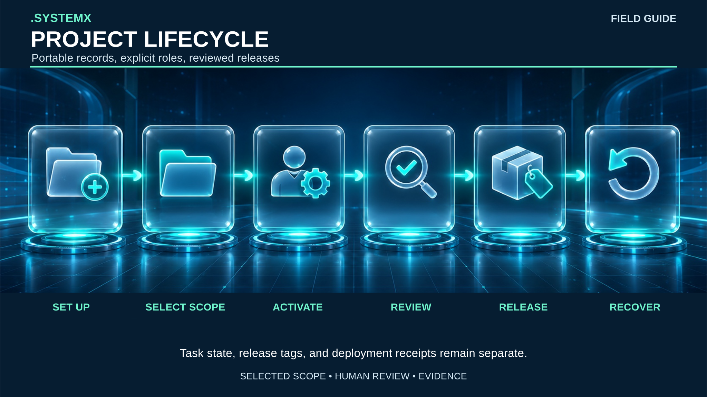
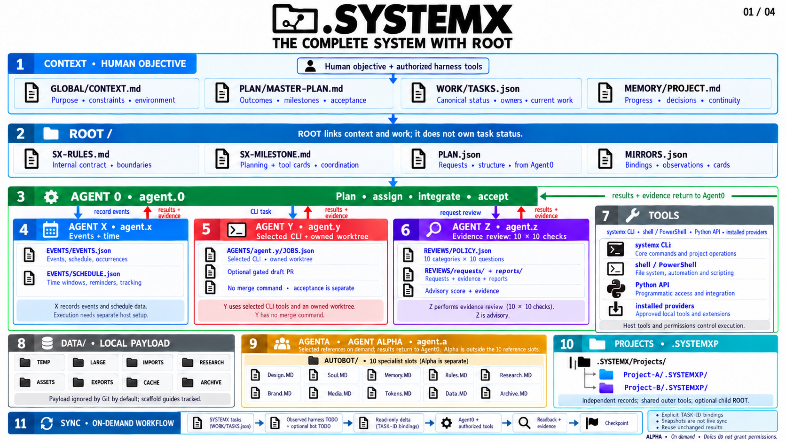

# .SYSTEMX


**Portable project context, memory, and coordination for work with AI assistants.**

`.SYSTEMX` keeps a project's objective, plan, task state, evidence, and next step
in a reviewable folder. People and authorized tools maintain those records so
another session can understand the work and continue from an explicit checkpoint.
The format is stack-neutral: it does not require a particular AI model, editor,
application framework, or cloud provider.

**Template version:** `1.11.0-beta.1` · **Python package metadata:** `1.11.0b1`

[Use this template](https://github.com/WayneTechLab/dotSYSTEMX/generate) ·
[First-time setup](https://github.com/WayneTechLab/dotSYSTEMX/wiki/First-Time-Setup) ·
[Manual](https://github.com/WayneTechLab/dotSYSTEMX/wiki) ·
[Current release report](docs/RELEASE-REPORT.md) ·
[White paper](.SYSTEMX/MEDIA/White-Paper/SYSTEMX-White-Paper.pdf) ·
[Beta visual guide](#beta-visual-guide) ·
[Historical four-part guide](#historical-four-part-guide)

> **BETA — USE AT YOUR OWN RISK.** The format may change and is provided without
> warranty. Review and pin a release, keep recoverable backups, and validate the
> result in your own project. Template checks do not certify an application or
> process as production ready. Read the
> [release policy](https://github.com/WayneTechLab/dotSYSTEMX/wiki/Release-Policy)
> and [version history](https://github.com/WayneTechLab/dotSYSTEMX/wiki/Versions-and-Changelog).

This beta adds opt-in Agent Beta BOT/DOT workspaces, Agent1 advisory security
checks, Agent Alpha Agenda settings, and default-deny role rows in the Access
Matrix. Existing projects retain their adopted files and update policy; a
template update does not start an agent or service or upload a secret.

## Add the folder to a project

The canonical name is exactly **`.SYSTEMX`**, including the leading dot and
uppercase letters. Install it inside the containing project directory. New
installations pin the selected defaults and use manual updates.

The optional command tools require **Python 3.9+** and use its standard library.
Reading the documents requires no Python process. Git is needed for the
Git-based package installation below. Your chosen app, IDE, or CLI supplies
models, execution tools, credentials, and permissions separately.

On macOS or Linux, run this from the containing project directory:

```bash
python3 -m venv "$HOME/.venvs/dotsystemx"
"$HOME/.venvs/dotsystemx/bin/python" -m pip install \
  "git+https://github.com/WayneTechLab/dotSYSTEMX.git@v1.11.0-beta.1"
systemx() { "$HOME/.venvs/dotsystemx/bin/python" -I -B -m systemx "$@"; }

systemx first-run --target "$PWD" --profile project --version 1.11.0-beta.1
systemx first-run --target "$PWD" --profile project --version 1.11.0-beta.1 --apply
systemx status --target "$PWD"
systemx run --target "$PWD" --offline -- validate
```

Inspect the preview before applying it. This short example selects an exact
release without an independent archive pin. For a SHA-256-pinned remote install,
obtain the exact release's **codeload tag ZIP** digest through a separately trusted
record and supply `--archive-sha256`. That digest differs from a folder-only
release archive's checksum. The
[installation guide](https://github.com/WayneTechLab/dotSYSTEMX/wiki/Installation-and-Updates)
explains verification, existing-installation migration, and recovery.

For [Windows PowerShell](https://github.com/WayneTechLab/dotSYSTEMX/wiki/First-Time-Setup),
a reviewed folder copy, or [chat and Drive profiles](https://github.com/WayneTechLab/dotSYSTEMX/wiki/Getting-Started),
follow the corresponding setup instructions. A URL alone does not grant file
access or make a chat's records persist.

Read [.SYSTEMX/START-HERE.md](.SYSTEMX/START-HERE.md), then fill in only known
project facts. Define one accepted outcome and one bounded task before expanding
the plan. The [new-chat setup prompt](https://github.com/WayneTechLab/dotSYSTEMX/wiki/New-Chat-Setup-Prompt)
and [daily workflow](https://github.com/WayneTechLab/dotSYSTEMX/wiki/Daily-Workflow)
provide complete adoption and resume examples.

## Keep one authority for work

| Record | Responsibility |
| --- | --- |
| `.SYSTEMX/GLOBAL/CONTEXT.md` | Objective, audience, agreed facts, constraints, and source references |
| `.SYSTEMX/PLAN/MASTER-PLAN.md` | Outcomes, milestones, dependencies, and acceptance criteria |
| `.SYSTEMX/WORK/TASKS.json` | Canonical task status, ownership, dependencies, and completion evidence |
| `.SYSTEMX/WORK/FOCUS.json` | Selected current objective and existing task IDs |
| `.SYSTEMX/MEMORY/PROJECT.md` | Reviewed facts and useful checkpoints |
| `.SYSTEMX/AGENTS/<id>/MEMORY.md` | A worker's scoped observations and handoff |
| `.SYSTEMX/GLOBAL/ACCESS-MATRIX.json` | Default-deny role catalog and optional reviewed access decisions; no external grant |
| `.SYSTEMX/GLOBAL/ACCESS-MATRIX.xlsx` | Human review view of the 20 stock role rows; JSON is authoritative |
| `.SYSTEMX/GLOBAL/ACCESS-MATRIX.md` | Access intent, gaps, and evidence guidance |
| `.SYSTEMX/PLAN/MAP.md` | Optional source locations, interfaces, and system boundaries |

`WORK/TASKS.json` generates the TODO, WORKING-ON, BLOCKED, REVIEW, DONE, and
CANCELLED views. Plans, memory, event records, reviews, and external task lists
do not create competing task ledgers. A typical task moves from `todo` through
`in_progress` and `needs_review` to accepted `done`, with original evidence and
Agent 0 or user review.

The reusable project records start blank. They do not contain an application's
features, a private backlog, provider credentials, or inherited project history.
See the [task workflow](https://github.com/WayneTechLab/dotSYSTEMX/wiki/Task-Workflow)
and [standard format](https://github.com/WayneTechLab/dotSYSTEMX/wiki/Standard-Format).

## Coordinate people, workers, and tools

| Role | Supported responsibility | Boundary |
| --- | --- | --- |
| Agent 0 | Plan, assign scope, resolve dependencies, integrate results, and record acceptance | A coordinator role; the host provides its model and tools |
| Agent X | Record events, original times, revisions, evidence, and due items | Tracks schedules without executing jobs |
| Agent Y | Carry an authorized task to one selected installed CLI in an owned Git worktree, with optional draft PR handoff | Separate context and permissions; acceptance, merge, and cleanup remain distinct |
| Agent Z | Present a versioned policy of 100 questions in ten categories and score supplied answers | Does not perform the checks or grant acceptance |
| Agent Alpha | Route explicit requests to selected AUTOBOT reference detail | Separate from the ten reference functions; starts no model |
| Agent Beta | Record named BOT/DOT workspaces and optional online identity references | Starts no provider or background process |
| Agent1 | Review security and access with advisory All-In-One checks | Opt-in `agent.1`; findings do not block by default or prove a host clean |

The public seed registry contains Agent 0 only. Role initialization adds blank
records without starting processes or granting permissions. Native subagents
come from the chosen app or IDE. Assign useful independent work with distinct
write scopes, serialize shared-record updates, and verify combined results.
The available host capacity determines concurrency.

The optional [Agent Beta, Agent1, and Agenda guide](docs/agent-beta-security-agenda.md)
defines the selected-scope records and commands. GitHub Actions secrets are
for workflow runtime and cannot be linked into a local `.env`. Agent1 separates
GitHub secret metadata and authorized upload from local credential handling;
the Access Matrix documents reviewed intent without granting permissions. A
read-only stdio session can be started explicitly and ends with its parent.
For an explicit repository or environment secret set, the CLI checks the
active GitHub account's repository admin permission before hidden input, then
reads back only name/scope metadata. A configured guest label is descriptive;
verified guest admins can proceed. Organization secret writes and local vault
delivery are outside this beta command.

On native Windows, Agent1's metadata-only first setup, status, questions, and
warning-only check remain available. Dotenv inventory/sanitization/migration,
`review --answers`, and changing an existing setup record fail closed because
their required anchored file-handle operations are unavailable. See the
[platform and setup limits](docs/agent-beta-security-agenda.md#session-and-platform-status)
before using those workflows.

The checked-in XLSX shows stock default-deny roles; `agenda workbook-export`
creates a revision-guarded, current spreadsheet under an adopted scope's
ignored `local/` directory. JSON decisions remain authoritative.
Agent Beta can attach a same-actor reviewed decision to an existing BOT/DOT
record through `agent-beta access-link` after a combined record/matrix revision
check; the link leaves the workspace offline and grants no external access.
The `session-settings` command returns one bounded read-only packet of selected
role status, Access Matrix revisions, and canonical Rules file paths and hashes
for an IDE or harness; it exposes no rule text or credentials. Use
`session-settings --compact` to receive a rule count and revision digest instead
of individual paths and hashes when a short status packet is enough.

Agent Y's provider does not inherit the app chat automatically. Its selected
executable is pinned at preparation and checked before execution. PR publication
requires task opt-in; Agent Y has no merge command. A Git worktree, path check,
or PR gate is a workflow control, not an operating-system sandbox. Consult the
[Agent Y manual](https://github.com/WayneTechLab/dotSYSTEMX/wiki/Agent-Y)
before enabling that lane. A target repository's workflows and webhooks may run
when a branch or PR is published; their authorization, cost, and effects remain
part of that project's operation.

For complete role guidance, use the
[Agent 0](https://github.com/WayneTechLab/dotSYSTEMX/wiki/Agent-0-and-Subagents),
[Agent X](https://github.com/WayneTechLab/dotSYSTEMX/wiki/Agent-X), and
[Agent Z](https://github.com/WayneTechLab/dotSYSTEMX/wiki/Agent-Z) manuals.

## Select scope and detail explicitly

**ROOT** adds optional internal rules, milestone structure, plan links, and
bounded tool cards. It binds saved harness or bot observations to existing
canonical task IDs and reports a read-only delta. Agent 0 uses actual authorized
tools to reconcile affected state and records a fresh readback. Matching saved
observations do not establish continuous synchronization, and tool cards do not
execute automatically. Read [SX-RULES](.SYSTEMX/ROOT/SX-RULES.md),
[SX-MILESTONE](.SYSTEMX/ROOT/SX-MILESTONE.md), and the
[ROOT manual](https://github.com/WayneTechLab/dotSYSTEMX/wiki/ROOT-Planning-and-Task-Delta).

**AUTOBOT** supplies ten on-demand reference functions for design, purpose and
voice, memory, rules, research, brand, media, design tokens, data, and archives.
Agent Alpha selects a bounded subset; matching unchanged requests can reuse
retained results. These documents are reference material, not ten running models
or another task ledger. Project-owned brand, font, media, and CSS references
remain generic until deliberately populated. See [AUTOBOT](.SYSTEMX/docs/AUTOBOT.md).

**DATA** holds local temporary inputs, large files, imports, research, assets,
exports, caches, and archives. Supplied Git rules ignore payloads by default.
Ignore rules do not encrypt data, remove tracked files, control cloud sharing,
or authorize uploads. Pointers do not automatically ingest payloads. Inspect
adopted settings with the [DATA tools](.SYSTEMX/docs/DATA.md).

**SYSTEMX PROJECTS** provides named `.SYSTEMXP` records under one outer
installation. Each child owns its context, plan, tasks, memory, and evidence,
while sharing reviewed outer tools and defaults. Select the child explicitly:

```bash
systemx projects --target "/path/to/workspace" -- add Project-A --kind software
systemx projects --target "/path/to/workspace" -- add Project-A --kind software --apply
systemx projects --target "/path/to/workspace" -- context --project Project-A --agent agent.0
```

Creation previews before `--apply`. The target is the containing workspace,
not the child `.SYSTEMXP` folder. Do not nest another `.SYSTEMX` inside it.
See [SYSTEMX PROJECTS](https://github.com/WayneTechLab/dotSYSTEMX/wiki/SYSTEMX-Projects)
and the [CLI and tools guide](.SYSTEMX/docs/CLI-TOOLS.md).

Records can live in a repository, local directory, accessible saved attachment,
or locally synchronized Drive folder. Existing authorized clients or connectors
provide transport. Use one cooperating writer per scope and verify revisions
before switching sessions; a local lock is not a distributed lock.

## Beta visual guide

The current imagegen-assisted AeroGlass infographics use a 7680 × 4320 SVG
canvas with exact vector labels and icons. Generated illustrative art has
1672 × 941 native pixels; the 8K canvas is an export size, not native generated
detail. Each guide has an [accessible text companion](.SYSTEMX/MEDIA/Reference/current-visual-guide.md)
with the same relationships in reading order. The images describe this beta
source; they do not claim that a provider connection, security control, or
deployment is live.

[](.SYSTEMX/MEDIA/Infographics/systemx-guide-lifecycle.svg)

| Current guide | Focus |
| --- | --- |
| [Lifecycle](.SYSTEMX/MEDIA/Infographics/systemx-guide-lifecycle.svg) | Setup, selected scope, verification, update and removal |
| [BOT/DOT workspaces](.SYSTEMX/MEDIA/Infographics/systemx-guide-bot-workspaces.svg) | Agent Beta metadata and external provider boundary |
| [Security and access](.SYSTEMX/MEDIA/Infographics/systemx-guide-security-access.svg) | Agent1 warnings, `.env` names, local versus CI secrets |
| [Access Matrix](.SYSTEMX/MEDIA/Infographics/systemx-guide-access-matrix.svg) | Default-deny roles, reviewed decisions, live workbook export |

There is also one [role card for each of Agent 0, X, Y, Z, Alpha, Beta and
Agent1](.SYSTEMX/MEDIA/Reference/current-visual-guide.md#agent-role-cards). The
[asset record](.SYSTEMX/MEDIA/Reference/ASSETS.json) identifies each file and
its generated-source and 8K canvas dimensions. Public links and text remain
usable without downloading a high-resolution raster export.

## Historical four-part guide

[](.SYSTEMX/MEDIA/Infographics/systemx-field-guide-01-overview-4k.jpg)

| Static guide | What it explains |
| --- | --- |
| [1. Whole-system overview](.SYSTEMX/MEDIA/Infographics/systemx-field-guide-01-overview-4k.jpg) | Records, agents, tools, ROOT, AUTOBOT, DATA, and scope |
| [2. Agent coordination](.SYSTEMX/MEDIA/Infographics/systemx-field-guide-02-agent-coordination-4k.jpg) | Observed task surfaces, authorized reconciliation, and readback |
| [3. ROOT and reference detail](.SYSTEMX/MEDIA/Infographics/systemx-field-guide-03-autobot-panel-4k.jpg) | Planning links, tool cards, Agent Alpha, and ten AUTOBOT functions |
| [4. DATA and project scopes](.SYSTEMX/MEDIA/Infographics/systemx-field-guide-04-data-projects-4k.jpg) | Independent child records, shared tools, local payloads, and lifecycle boundaries |

The [text companion](.SYSTEMX/MEDIA/Reference/systemx-field-guide.md) provides
accessible explanations and commands. The
[asset record](.SYSTEMX/MEDIA/Reference/ASSETS.json) distinguishes generated source
dimensions from the 3840 × 2160 export canvases. The artwork retains its alpha.3
media identity. [Use-case graphics](https://github.com/WayneTechLab/dotSYSTEMX/wiki/Use-Case-Infographics)
and the [visual manual](https://github.com/WayneTechLab/dotSYSTEMX/wiki/Visual-Guide)
cover other environments and static diagrams.

## Video guide: The Guided Folder

[](https://www.youtube.com/watch?v=77ZUBxEciXk)

[Watch .SYSTEMX — The Guided Folder on YouTube](https://www.youtube.com/watch?v=77ZUBxEciXk).

The animated walkthrough demonstrates software **1.11.0-alpha.6**. Its media
edition is separate from this beta software version; it does not demonstrate
the Agent Beta, Agent1, or Agenda features.

## White paper and operating manual

[**Portable Project Coordination for AI-Assisted Work**](.SYSTEMX/MEDIA/White-Paper/SYSTEMX-White-Paper.pdf)
is the current five-page technical white paper, edition 2.1, examining
`1.11.0-beta.1`. Historical edition 2.0 examined alpha.4 and was published
with alpha.5; its original bytes remain available in that tagged history.
Resource examples are illustrative, not measured savings or autonomous
completion claims.

[Editable manuscript](.SYSTEMX/MEDIA/White-Paper/SYSTEMX-White-Paper.md) ·
[Paper metadata](.SYSTEMX/MEDIA/White-Paper/SYSTEMX-White-Paper.json) ·
[Paper manual](https://github.com/WayneTechLab/dotSYSTEMX/wiki/White-Paper)

The [wiki manual](https://github.com/WayneTechLab/dotSYSTEMX/wiki) covers setup,
commands, prompts, security, troubleshooting, and release history. For a larger
project, the [one-shot guide](https://github.com/WayneTechLab/dotSYSTEMX/wiki/One-Shot-Project-Guide)
connects a researched brief to milestones, bounded tasks, execution, and review.
“One shot” describes the starting brief, not a promise of one-response completion.

## Preserve work and verify outcomes

Ordinary managed updates add selected versioned defaults and preserve adopted
project files and older snapshots. Stock root bootstrap replacement is a
separate reviewed operation with backups. Startup checks are opt-in notices;
they do not select a new version. Use the
[upgrade](https://github.com/WayneTechLab/dotSYSTEMX/wiki/Installation-and-Updates)
and [logged uninstall/restore](https://github.com/WayneTechLab/dotSYSTEMX/wiki/Uninstall-and-Cleanup)
guides before changing an active installation.

Format validation establishes record consistency within its stated scope. It
does not establish application correctness, deployment, live provider behavior,
production readiness, or owner acceptance. Keep failed and skipped checks
visible, retain original evidence, and recheck facts that can change.

Selected context may reduce repeated explanations and avoidable rework.
Maintaining records and coordinating workers also consumes time and tokens.
Measure the complete workflow against a practical alternative; no universal
savings percentage, billing result, speed improvement, or model-quality result
is promised. See [tokens, cost, and time](https://github.com/WayneTechLab/dotSYSTEMX/wiki/Tokens-Cost-and-Time)
and [evidence and acceptance](https://github.com/WayneTechLab/dotSYSTEMX/wiki/Evidence-and-Acceptance).

For untrusted prompts or providers, use actual host isolation and limit available
credentials and files. Role labels, an access matrix, and allowed-path checks are
not authentication or operating-system access control. The template installs no
hosted application, background agent runtime, cloud connector, or MCP server.
Application SDKs, business integrations, and live credentials belong in the
adopting project. The repository's [template CI](.github/workflows/template-ci.yml)
runs read-only tests on a small OS/Python matrix; it does not use secrets or
deploy an application. An on-demand [release counter](.SYSTEMX/docs/RELEASE-COUNTERS.md)
reports published template releases separately from GitHub deployment records,
with an observation time and unknown status when the provider cannot be read.
Run `bash .SYSTEMX/SYSTEMX.sh release-counters` from a reviewed checkout or
use local menu option 32. It never increments a counter or deploys code.
Large authoring projects, including Blender sources, belong in external or
ignored project storage; the public template ships only reviewed references and
current publication assets.

## Support, license, and provenance

[Contributing](CONTRIBUTING.md) · [Support](SUPPORT.md) ·
[Security](SECURITY.md) · [MIT License](LICENSE)

A product of **Wayne Tech Lab LLC**, created by **Lucas (SatoshiUNO)**.
[Networks.Chat](https://Networks.Chat) · [WayneTechLab.com](https://WayneTechLab.com)

[Source provenance](.SYSTEMX/SOURCE.json) records the standalone template's
relationship to its private upstream. This repository is the public source.
Keep project-owned private records out of public exports and retain the license
and attribution when redistributing the folder.
