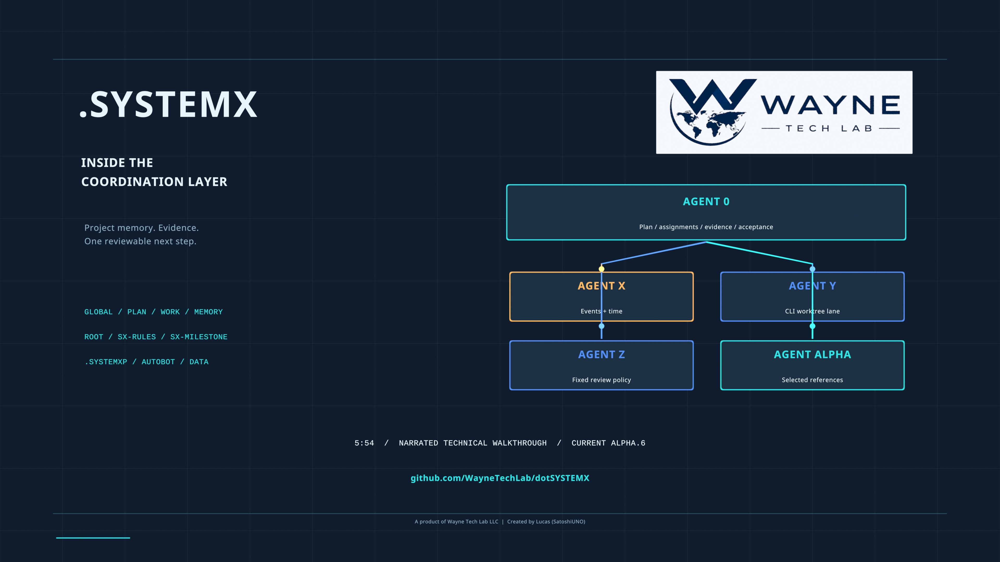

# Advanced walkthrough: inside the coordination layer

Media edition **2.0** examines the implemented `.SYSTEMX` **1.11.0-alpha.6**
release at commit `f942daf38fc7f1661910912dbcf07faaec5ad7aa`. The film explains
how the existing records, tools, and acceptance boundaries work together. Its
examples do not announce a future feature or change the software release.

[Watch the film](https://www.youtube.com/watch?v=pLQu1JAZfRU) ·
[Download the Full HD MP4](https://github.com/WayneTechLab/dotSYSTEMX/releases/download/media-advanced-v2.0/SYSTEMX-Advanced-Walkthrough-v2.0.mp4) ·
[Native 4K poster](https://github.com/WayneTechLab/dotSYSTEMX/releases/download/media-advanced-v2.0/SYSTEMX-Advanced-Walkthrough-v2.0-poster-4K.jpg) ·
[Read the transcript](TRANSCRIPT.md) ·
[English captions](https://github.com/WayneTechLab/dotSYSTEMX/releases/download/media-advanced-v2.0/SYSTEMX-Advanced-Walkthrough-v2.0.srt) ·
[Copyable prompts](PROMPTS.md) ·
[Context demonstration](CONTEXT-DEMO.md)

The film runs **5:53.917**, rounded to **5 minutes 54 seconds**. It is native
**1920 × 1080 at 24 fps**, with 18 animated Blender scenes and synthetic Kokoro
`af_heart` narration. It is not a recording of the creator. The separate poster
was rendered at **3840 × 2160**. A 4K poster does not make the film 4K.

## Follow the workflow

Begin with an outcome, audience, constraints, available sources, and actual tool
permissions. [The initial brief](PROMPTS.md#1-initial-brief-establish-the-project-and-first-accepted-milestone)
records those decisions. [The follow-up prompt](PROMPTS.md#2-bounded-follow-up-complete-the-next-task-without-replaying-the-project)
selects one task, scope, revision, acceptance condition, and next check.

The examples distinguish the responsibilities of the records and their host:

- **Agent 0** coordinates accepted work and host-native subagents when the host
  actually provides them. Role registration alone starts no process.
- **Agent Y** is the separately installed CLI lane, with scoped worktrees,
  evidence, optional authorized draft PRs, and distinct acceptance/cleanup gates.
  The film explains this existing capability; the local demonstration executes
  no provider worker and opens no PR.
- **Agent X** records observed events and due-item bookkeeping. A schedule record
  does not register or execute an OS or cloud job.
- **Agent Z** retains the fixed 100-question policy and scores supplied answers.
  The score is advisory; evidence and task acceptance remain separate.
- **ROOT** compares canonical task records with saved harness or optional bot
  observations. Actual authorized tools must apply and read back any external
  changes. Equal-looking observations do not prove continuous live sync.
- **Agent Alpha** selects relevant references from the ten AUTOBOT functions.
  These files supply context; they are not ten running models.
- **DATA** holds local payloads with Git exclusions. An ignore rule is not access
  control, encryption, or a cloud connector.
- **Named `.SYSTEMXP` scopes** own separate context, plans, tasks, memory, and
  evidence while sharing reviewed outer tools. Select the project explicitly.

Use the [CLI and tools manual](../../../.SYSTEMX/docs/CLI-TOOLS.md),
[ROOT rules](../../../.SYSTEMX/ROOT/SX-RULES.md), and
[project-scope guide](../../../.SYSTEMX/docs/PROJECTS.md) for executable details.
The [first-time setup](https://github.com/WayneTechLab/dotSYSTEMX/wiki/First-Time-Setup)
and [daily workflow](https://github.com/WayneTechLab/dotSYSTEMX/wiki/Daily-Workflow)
manuals explain adoption and resuming an existing project.

## Chapters and accessibility

The original MP4 retains **18 chapter markers**. The supplied YouTube navigation
list has **17 entries** because the opening brand scene and project-context scene
share its first entry. The supplied English SRT contains **59 cues**. The
[transcript](TRANSCRIPT.md) provides the same narration as text, and the
[prompts](PROMPTS.md) and [methodology](CONTEXT-DEMO.md) preserve the detailed
instructions and qualifications behind the diagrams.

| Start | Topic |
| --- | --- |
| [00:00](https://www.youtube.com/watch?v=pLQu1JAZfRU&t=0s) | Wayne Tech Lab presents .SYSTEMX |
| [00:23](https://www.youtube.com/watch?v=pLQu1JAZfRU&t=23s) | A headless coordination layer |
| [00:42](https://www.youtube.com/watch?v=pLQu1JAZfRU&t=42s) | Turn the idea into accepted work |
| [01:02](https://www.youtube.com/watch?v=pLQu1JAZfRU&t=62s) | A rich brief. A bounded follow-up. |
| [01:21](https://www.youtube.com/watch?v=pLQu1JAZfRU&t=81s) | Agent 0 and native subagents |
| [01:40](https://www.youtube.com/watch?v=pLQu1JAZfRU&t=100s) | Agent Y: the external CLI lane |
| [02:02](https://www.youtube.com/watch?v=pLQu1JAZfRU&t=122s) | Agent X: time and interruptions |
| [02:22](https://www.youtube.com/watch?v=pLQu1JAZfRU&t=142s) | Agent Z: repeatable evidence review |
| [02:44](https://www.youtube.com/watch?v=pLQu1JAZfRU&t=164s) | ROOT: three TODO surfaces |
| [03:04](https://www.youtube.com/watch?v=pLQu1JAZfRU&t=184s) | Agent Alpha and AUTOBOT |
| [03:25](https://www.youtube.com/watch?v=pLQu1JAZfRU&t=205s) | DATA and permission boundaries |
| [03:43](https://www.youtube.com/watch?v=pLQu1JAZfRU&t=223s) | One workspace, multiple projects |
| [04:02](https://www.youtube.com/watch?v=pLQu1JAZfRU&t=242s) | Current setup locations |
| [04:21](https://www.youtube.com/watch?v=pLQu1JAZfRU&t=261s) | Measure the context budget |
| [04:53](https://www.youtube.com/watch?v=pLQu1JAZfRU&t=293s) | Adopt reviewed defaults, keep project records |
| [05:13](https://www.youtube.com/watch?v=pLQu1JAZfRU&t=313s) | Inspect the recorded state |
| [05:35](https://www.youtube.com/watch?v=pLQu1JAZfRU&t=335s) | Begin with a small pilot |

[Download the chapter list](https://github.com/WayneTechLab/dotSYSTEMX/releases/download/media-advanced-v2.0/SYSTEMX-Advanced-Walkthrough-v2.0-YouTube-chapters.txt).
Chapter URLs address the public watch page; use the downloaded MP4's markers when
working offline.

## What the local demonstration establishes

The production records retain **39 actual local CLI/check executions** using a
fresh disposable alpha.6 copy. Two named scopes keep a synthetic WebApp fixture
and research task separate. Project-A changes from two TODO tasks, to one in
progress, to one done and one needing review, and then to two accepted fixture
tasks. Project-B retains one TODO; the outer workspace task ledger remains blank.

A real Python check compares **20 local HTML filenames** with their retained
inventory. Those files are educational fixtures, not a finished 20-page WebApp.
The CLI refuses an initial in-progress transition without a concrete next action;
the corrected command supplies one. Task dependency readiness, explicit review,
Agent X records, selected AUTOBOT context, and record validation are exercised.
Agent Z calculates **3/100 with 97 unknown answers**, reflecting only three
supplied judgments rather than a readiness rating.

An explicitly synthetic harness snapshot remains `pending` while its canonical
task becomes `done`. The selected `root delta --task TASK-002` reports
`stale_canonical` and `state_difference`, with `liveSyncVerified: false` and
`executed: false`. The fixture is a saved observation; no real IDE plan was
fetched. No model, external CLI worker, PR, cloud deployment, or scheduler was
started by this walkthrough.

These 39 executions are separate from the **14 local commands** used by the
context-counting demonstration below. Neither is a complete application test
suite or evidence of model performance.

## Measure selected context honestly

The [methodology](CONTEXT-DEMO.md) and
[reproduction pack](https://github.com/WayneTechLab/dotSYSTEMX/releases/download/media-advanced-v2.0/SYSTEMX-Context-Demo-v1.0.zip)
compare authored synthetic inputs with **tiktoken 0.14.0 / `o200k_base`**.
They do not measure provider-reported usage or billed tokens.

| Constructed case / input tokens | Full history or direct request | SYSTEMX packet | Ordinary compact handoff |
| --- | ---: | ---: | ---: |
| Long project: per resume | 7,475 | 1,008 | 396 |
| Long project: one-time setup/readback | 0 | 8,547 | 7,733 |
| Long project: first use including setup | 7,475 | 9,555 | 8,129 |
| Small one-step task: per resume | 98 | 805 | 195 |
| Small task: first use including setup | 98 | 1,814 | 416 |

All three long inputs retain the same **12 declared fact groups**; the small
case retains four. **17 known-bad controls** verify the limited fact-availability
checker's sensitivity. This does not test whether an LLM follows or uses those
facts. Selected packets omit archival detail and may require another authorized
read. Setup, maintenance, hidden host/tool framing, output, retries, cache effects,
and actual workload must be included in a real evaluation.

The compact plain handoff is smaller than the structured packet in this fixture,
and both tracked workflows cost more input on first use. The film claims no
measured money savings, latency improvement, model learning, autonomous throughput,
or general security result.

## Downloads, provenance, and editable production

| Download | Purpose |
| --- | --- |
| [Full HD MP4](https://github.com/WayneTechLab/dotSYSTEMX/releases/download/media-advanced-v2.0/SYSTEMX-Advanced-Walkthrough-v2.0.mp4) | H.264 film, final audio, and native chapter markers |
| [Native 4K JPEG](https://github.com/WayneTechLab/dotSYSTEMX/releases/download/media-advanced-v2.0/SYSTEMX-Advanced-Walkthrough-v2.0-poster-4K.jpg) | Standalone poster and custom thumbnail |
| [English SRT](https://github.com/WayneTechLab/dotSYSTEMX/releases/download/media-advanced-v2.0/SYSTEMX-Advanced-Walkthrough-v2.0.srt) | 59 caption cues |
| [Narration source](https://github.com/WayneTechLab/dotSYSTEMX/releases/download/media-advanced-v2.0/SYSTEMX-Advanced-Walkthrough-v2.0-narration.md) | Editable transcript, also [readable here](TRANSCRIPT.md) |
| [Prompt examples](https://github.com/WayneTechLab/dotSYSTEMX/releases/download/media-advanced-v2.0/SYSTEMX-Advanced-Walkthrough-v2.0-prompts.md) | Initial brief and bounded continuation |
| [YouTube chapter list](https://github.com/WayneTechLab/dotSYSTEMX/releases/download/media-advanced-v2.0/SYSTEMX-Advanced-Walkthrough-v2.0-YouTube-chapters.txt) | 17 navigation entries |
| [Blender project](https://github.com/WayneTechLab/dotSYSTEMX/releases/download/media-advanced-v2.0/SYSTEMX-Advanced-Walkthrough-v2.0.blend) | Editable production with packed final mix and retained muted narration stems |
| [Context demonstration ZIP](https://github.com/WayneTechLab/dotSYSTEMX/releases/download/media-advanced-v2.0/SYSTEMX-Context-Demo-v1.0.zip) | 67 publication files: scripts, synthetic inputs, results, chart data, source/tokenizer notes, and checksums |
| [Context methodology](https://github.com/WayneTechLab/dotSYSTEMX/releases/download/media-advanced-v2.0/SYSTEMX-Context-Demo-METHODOLOGY.md) | Measurement and reproduction limits, also [readable here](CONTEXT-DEMO.md) |
| [Delivery record](https://github.com/WayneTechLab/dotSYSTEMX/releases/download/media-advanced-v2.0/DELIVERY.json) | Source pin, dimensions, production identities, and recorded media checks |
| [SHA256SUMS](https://github.com/WayneTechLab/dotSYSTEMX/releases/download/media-advanced-v2.0/SHA256SUMS) | Exact identities of the prepared release files |
| [Third-party notices](https://github.com/WayneTechLab/dotSYSTEMX/releases/download/media-advanced-v2.0/THIRD-PARTY-NOTICES.txt) | Font copyright and full SIL OFL notices, narration/tool provenance, and retained component licenses |

The media release contains **13 assets**. [ASSETS.json](ASSETS.json) records their
asset names, byte sizes, hashes, software
baseline, and media identifiers. Large video and authoring files remain release
assets rather than portable `.SYSTEMX` defaults. Media edition **2.0**, the
`media-advanced-v2.0` release, software **1.11.0-alpha.6**, and white paper edition
**2.0** are separate identifiers. The media tag is not a software version and is
excluded by the current template version parser.

The context pack contains authored synthetic records and sanitized readbacks.
The private production environment, tokenizer cache, installation logs, and raw
local CLI receipts are not included. Reviewing publication files for private paths
and credential markers is a scoped check, not a guarantee that arbitrary inputs
are safe. The public template's records, manifest, and software version remain
unchanged by this documentation and media publication.

The editable project retains its packed font notices. Noto Sans and Liberation
Mono font software remains under **SIL OFL 1.1**; it is not relicensed as MIT.
The downloadable third-party notice preserves the relevant font, narration-tool,
and tokenizer terms. Model/voice weights, the Blender application, and the
tokenizer runtime/cache are not bundled. Public JPEG/Blender metadata has been
sanitized without changing compressed poster pixels, scene content, or packed
media bytes; the MP4 and SRT are unchanged.

Created by **Lucas (SatoshiUNO)**. A product of **Wayne Tech Lab LLC**.
[Networks.Chat portfolio](https://Networks.Chat) ·
[WayneTechLab.com business](https://WayneTechLab.com) ·
[Repository](https://github.com/WayneTechLab/dotSYSTEMX) ·
[Wiki manual](https://github.com/WayneTechLab/dotSYSTEMX/wiki)

**Alpha / experimental — use at your own risk.** This film describes the examined
implementation, not production certification, a managed service, or an automatic
cloud/IDE integration. The earlier [1:50 introduction](../introduction/README.md)
and frozen white paper retain their own baselines and evidence.
