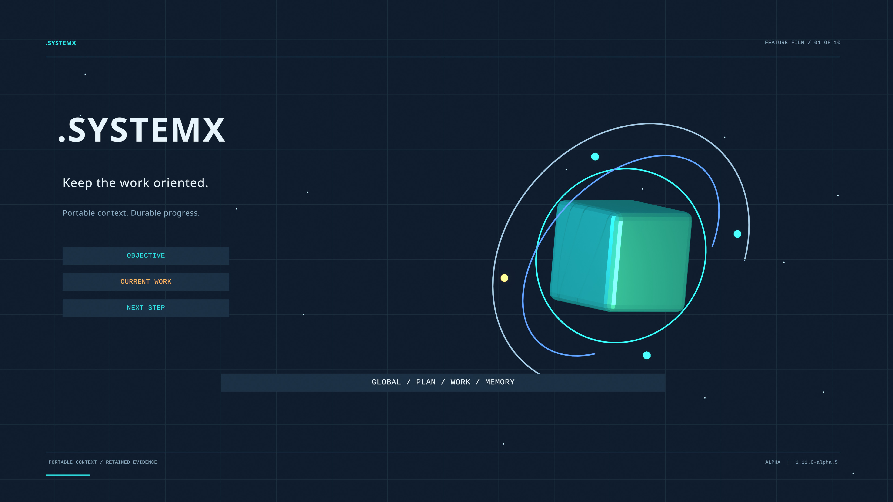

# .SYSTEMX introduction film

**Keep the Work Oriented** is an approximately **1 minute 50 second** animated
introduction to portable project context and coordination. It covers the objective,
Master Plan, canonical tasks and memory; Agent 0/X/Y/Z; Agent Alpha and the ten
AUTOBOT reference functions; ROOT and observed TODOs; `.SYSTEMXP` scopes; DATA;
and CLI, library, update, and recovery workflows.

[Watch on YouTube](https://www.youtube.com/watch?v=-EM-T6uNQAs) ·
[Download the Full HD MP4](https://github.com/WayneTechLab/dotSYSTEMX/releases/download/media-intro-v1.0/SYSTEMX-Introduction-v1.0.mp4) ·
[Download the 4K poster](https://github.com/WayneTechLab/dotSYSTEMX/releases/download/media-intro-v1.0/SYSTEMX-Introduction-v1.0-poster-4K.jpg) ·
[Read the transcript](TRANSCRIPT.md) ·
[English captions](https://github.com/WayneTechLab/dotSYSTEMX/releases/download/media-intro-v1.0/SYSTEMX-Introduction-v1.0.srt) ·
[Wiki guide](https://github.com/WayneTechLab/dotSYSTEMX/wiki/Introductory-Video)

The linked 4K poster opens the public YouTube video on the
[Wayne Tech Lab channel](https://www.youtube.com/@WayneTechLab). The film is
**1080p**, while its uploaded custom thumbnail is **3840 × 2160**; YouTube may
serve smaller thumbnail renditions. The visible captions support muted playback,
and the supplied English caption track is selectable on YouTube. The original
MP4, SRT, and plain-text transcript remain available in the media release.

## YouTube chapters

| Start | Topic |
| --- | --- |
| [00:00](https://www.youtube.com/watch?v=-EM-T6uNQAs&t=0s) | Portable project context and the task ledger |
| [00:19](https://www.youtube.com/watch?v=-EM-T6uNQAs&t=19s) | Agent 0, Agent X, and Agent Z |
| [00:30](https://www.youtube.com/watch?v=-EM-T6uNQAs&t=30s) | Agent Y and delegated CLI tasks |
| [00:40](https://www.youtube.com/watch?v=-EM-T6uNQAs&t=40s) | ROOT and the three TODO lists |
| [00:52](https://www.youtube.com/watch?v=-EM-T6uNQAs&t=52s) | Agent Alpha and the AUTOBOT references |
| [01:04](https://www.youtube.com/watch?v=-EM-T6uNQAs&t=64s) | Multi-project scopes with `.SYSTEMXP` |
| [01:14](https://www.youtube.com/watch?v=-EM-T6uNQAs&t=74s) | DATA and local project material |
| [01:26](https://www.youtube.com/watch?v=-EM-T6uNQAs&t=86s) | Install, pin, preserve, and restore |
| [01:38](https://www.youtube.com/watch?v=-EM-T6uNQAs&t=98s) | Keep the work oriented |

The film contains ten animated scenes and ten native MP4 chapter markers.
YouTube combines the first two scenes into one chapter so each of its nine
chapters lasts at least ten seconds. The picture, narration, and runtime are
the same in both versions.

## Format and identity

| Item | Published format |
| --- | --- |
| Film | 1920 × 1080, 24 fps, 109.833333 seconds, H.264 MP4 |
| Sound | Stereo AAC, 48 kHz; synthetic narration and an original ambient score |
| Poster | 3840 × 2160 JPEG, exported from the native Blender 4K render |
| Navigation | Nine YouTube chapters; ten native MP4 chapter markers; English captions |
| Public watch page | [YouTube introduction](https://www.youtube.com/watch?v=-EM-T6uNQAs) |
| Media edition | `1.0`, tag `media-intro-v1.0` |
| Feature baseline | `.SYSTEMX 1.11.0-alpha.5` |

The [asset record](ASSETS.json) supplies exact file sizes, SHA-256 digests,
feature baseline, and credits. The release's `SHA256SUMS` covers its downloadable
files. This media tag is not a template version and is ignored by template release
discovery. The current installer remains `1.11.0-alpha.5`.

The original film is hosted as a release asset rather than copied into the portable
`.SYSTEMX` distribution. Media production libraries, model weights, raw frames,
and the local Blender authoring project are not installation dependencies.

## Scope and credits

This is an illustrated alpha feature overview. Agent Z scores supplied answers;
Agent X records time and due items; actual authorized tools execute work and
reconcile external state. ROOT observations do not create a continuous connector,
DATA ignore rules do not establish privacy, and token/time benefits require
measurement. See the [manual](https://github.com/WayneTechLab/dotSYSTEMX/wiki)
and [white paper](https://github.com/WayneTechLab/dotSYSTEMX/wiki/White-Paper)
for the operating contract and evidence limits.

Created by **Lucas (SatoshiUNO)**. A product of **Wayne Tech Lab LLC**.
[Networks.Chat portfolio](https://Networks.Chat) ·
[WayneTechLab.com business](https://WayneTechLab.com).

The film was animated in Blender. Narration uses the Apache-2.0 Kokoro-82M model
through the MIT `kokoro-onnx` runtime. Rendered Noto Sans and Liberation Mono
are SIL-OFL typefaces. Music and transition sounds are original procedural synthesis.
Ten native Blender scenes supply the animation, with synthetic narration and original sound.
