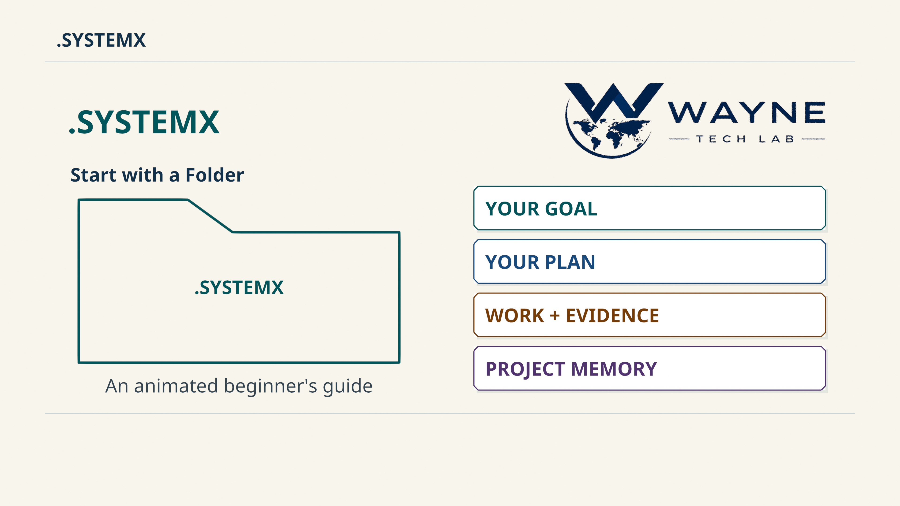

# Start with a Folder

An animated beginner's guide to `.SYSTEMX`: **9 minutes 55 seconds**, native
**3840 × 2160 at 30 fps**. One small, synthetic community garden website gives
the records and roles a concrete purpose before introducing the wider system.

[](https://www.youtube.com/watch?v=k1-CQYZnSYM)

[Watch the film](https://www.youtube.com/watch?v=k1-CQYZnSYM) ·
[Download the native 4K MP4](https://github.com/WayneTechLab/dotSYSTEMX/releases/download/media-field-guide-v3.0/SYSTEMX-Start-with-a-Folder-v3.0-4K.mp4) ·
[Native 4K poster](https://github.com/WayneTechLab/dotSYSTEMX/releases/download/media-field-guide-v3.0/SYSTEMX-Start-with-a-Folder-v3.0-poster-4K.jpg) ·
[Read the transcript](TRANSCRIPT.md) ·
[English SDH captions](CAPTIONS.srt) ·
[Media release and downloads](https://github.com/WayneTechLab/dotSYSTEMX/releases/tag/media-field-guide-v3.0)

**Video edition 3.0** is a media identity. The examined software remains
**1.11.0-alpha.6**. This publication adds no runtime feature, version bump,
project history, or populated records to the portable template. The
[1:50 introduction](../introduction/README.md) and
[5:54 advanced walkthrough](../advanced-walkthrough/README.md) remain available
with their original baselines and evidence.

## Follow one useful project

The film begins with a folder holding the goal, plan, work, evidence, and next
step. It introduces context, the Master Plan, the canonical task ledger, and
reviewed memory through an information page for a community garden. A deliberately
missing opening-hours section causes the synthetic check to fail; the corrected
page is checked again. Accepted completion still requires review against the
original criteria.

The later chapters connect that task to the wider format:

- **Agent 0** coordinates scope, ownership, dependencies, integration, and
  acceptance. The chosen app starts its supported native subagents.
- **Agent X** retains meaningful events, times, revisions, and evidence. Due-item
  bookkeeping does not run a scheduled job.
- **Agent Y** supports a selected installed CLI, owned worktree, and optional
  authorized draft PR. Acceptance, a separately authorized merge, and cleanup
  remain distinct. Its lane does not merge code itself.
- **Agent Z** scores supplied answers against its policy's same 100 questions.
  Unknowns remain visible; the score advises rather than accepts a task.
- **ROOT** links saved harness/bot observations to canonical task identities and
  reports differences. It does not fetch live providers or synchronize every
  task list continuously. Different lists can have different item counts.
- **Agent Alpha** selects relevant references from ten AUTOBOT functions. These
  are reference drawers, not ten running models or another task ledger.
- **DATA** holds owner-managed payloads. Git exclusions do not provide encryption,
  cloud sharing policy, or permission to upload a referenced file.
- **Named `.SYSTEMXP` scopes** keep context, plans, tasks, and memory separate
  while sharing reviewed outer tools. Select the project for every handoff.

The format is headless: it requires no particular graphical control app or
running server. Reading the records needs no Python process. The optional command
tools require Python 3.9+; the host supplies its model, actual tools, and permissions.
A role entry, folder, prompt, or web address does not create a worker or connection.

Read [START-HERE](../../../.SYSTEMX/START-HERE.md), the
[CLI/tool guide](../../../.SYSTEMX/docs/CLI-TOOLS.md), and the
[manual](https://github.com/WayneTechLab/dotSYSTEMX/wiki) when adopting the format.

## A starting prompt

Replace the example project with your own authorized objective and location:

```text
Use this project's existing .SYSTEMX. Read the current context, Master Plan,
task ledger, and next step. Help me finish the community garden website.
Identify finished work, plan the next bounded tasks, use available authorized
tools, and save verified results. Ask when a decision or access is missing.
```

First confirm that the assistant actually has authorized access to the selected
records and source files. This prompt installs no tools and grants no credentials
or permission. Resume an existing accepted plan before replacing it. The
[advanced prompt examples](../advanced-walkthrough/PROMPTS.md) provide a richer
initial brief and a bounded follow-up.

## Chapters, transcript, and captions

The finished film contains **17,850 frames**, **30 animated scenes**, and
**12 chapters**. Its English SDH file contains **120 cues**, including relevant
sound descriptions. The transcript preserves the frozen narration and chapter/
scene start times; the SRT supplies the selected timed-caption source.

| Start | Chapter |
| --- | --- |
| [00:00](https://www.youtube.com/watch?v=k1-CQYZnSYM&t=0s) | A place to begin |
| [00:35](https://www.youtube.com/watch?v=k1-CQYZnSYM&t=35s) | Folder, records, tools |
| [01:33](https://www.youtube.com/watch?v=k1-CQYZnSYM&t=93s) | Find your way around |
| [02:32](https://www.youtube.com/watch?v=k1-CQYZnSYM&t=152s) | Follow one task |
| [03:49](https://www.youtube.com/watch?v=k1-CQYZnSYM&t=229s) | What to say to your assistant |
| [04:29](https://www.youtube.com/watch?v=k1-CQYZnSYM&t=269s) | Useful parallel work |
| [05:26](https://www.youtube.com/watch?v=k1-CQYZnSYM&t=326s) | Three task surfaces |
| [06:23](https://www.youtube.com/watch?v=k1-CQYZnSYM&t=383s) | Open only the right drawer |
| [07:26](https://www.youtube.com/watch?v=k1-CQYZnSYM&t=446s) | Data and independent projects |
| [08:27](https://www.youtube.com/watch?v=k1-CQYZnSYM&t=507s) | Resume without starting over |
| [09:08](https://www.youtube.com/watch?v=k1-CQYZnSYM&t=548s) | Control and recover |
| [09:34](https://www.youtube.com/watch?v=k1-CQYZnSYM&t=574s) | Begin with one project |

The chapter links use whole-second positions on the watch page. The transcript
retains precise half-second scene/chapter times where applicable. The selected
caption timing used ASR-assisted timestamps matched to authored narration with
sound descriptions and reading-time adjustments. It does not claim forced
phonetic alignment, full human listening acceptance, or accessibility certification.

## What the example establishes

The community garden story and intentionally failing check are synthetic teaching
material. They show a bounded task, an observable gap, correction, rechecking,
and review. They do not establish a deployed website, a real provider job or PR,
a completed commercial application, model learning, autonomous throughput, or a
new integration. The software's blank project records remain generic.

Selected context can reduce repeated explanation, while maintaining and checking
records also costs time and tokens. Measure the complete workflow against your
current practice. This film claims no measured bills, cost savings, processing
speed improvement, or universal productivity result. The separate
[constructed context demonstration](../advanced-walkthrough/CONTEXT-DEMO.md)
retains its own methods, controls, counts, and limits.

## Download and verify

| File | Purpose |
| --- | --- |
| [4K MP4](https://github.com/WayneTechLab/dotSYSTEMX/releases/download/media-field-guide-v3.0/SYSTEMX-Start-with-a-Folder-v3.0-4K.mp4) | Finished 9:55 film, native 3840 × 2160 at 30 fps |
| [Poster](https://github.com/WayneTechLab/dotSYSTEMX/releases/download/media-field-guide-v3.0/SYSTEMX-Start-with-a-Folder-v3.0-poster-4K.jpg) | Compact native 4K JPEG |
| [Caption download](https://github.com/WayneTechLab/dotSYSTEMX/releases/download/media-field-guide-v3.0/SYSTEMX-Start-with-a-Folder-v3.0.srt) | English SDH SRT; [repository copy](CAPTIONS.srt) |
| [Transcript download](https://github.com/WayneTechLab/dotSYSTEMX/releases/download/media-field-guide-v3.0/SYSTEMX-Start-with-a-Folder-v3.0-Transcript.md) | Frozen narration; [repository copy](TRANSCRIPT.md) |
| [Component notices](https://github.com/WayneTechLab/dotSYSTEMX/releases/download/media-field-guide-v3.0/THIRD-PARTY-NOTICES.txt) | Full third-party terms and public production provenance; [repository copy](THIRD-PARTY-NOTICES.txt) |
| [Public asset manifest](https://github.com/WayneTechLab/dotSYSTEMX/releases/download/media-field-guide-v3.0/RELEASE-ASSETS.json) | Final rendered-media identities; [repository copy](RELEASE-ASSETS.json) |
| [Release checksums](https://github.com/WayneTechLab/dotSYSTEMX/releases/download/media-field-guide-v3.0/SHA256SUMS) | Six other release-file identities |

[ASSETS.json](ASSETS.json) records the media/software distinction, source pin,
core file identities, and readable companion identities. The local
[SHA256SUMS](SHA256SUMS) covers the copied transcript, captions, notices,
film/caption checksum note, sanitized public manifest, and repository poster.
It excludes the mutable
publication metadata itself. [FILM-SHA256SUMS.txt](FILM-SHA256SUMS.txt) separately
retains the prepared MP4/SRT identities under their release filenames; those
checksums are media identities, not the software codeload installation pin.

The public release contains **seven files**: the film, poster, captions,
transcript, notices, public manifest, and release checksums. Editable authoring
projects and private production evidence are excluded. The large MP4 stays in
the media release. The repository contains the
compact poster and text companions, without adding production logs, test projects,
render caches, or media-authoring dependencies to `.SYSTEMX`. The current
[software release](https://github.com/WayneTechLab/dotSYSTEMX/releases/tag/v1.11.0-alpha.6)
keeps its own version and immutable artifacts.

## Production and component terms

Narration is locally synthesized American English using Kokoro `af_heart`, not
an owner recording or named-person voice clone. Original procedural music and
paper/pen/page/click/chime Foley accompany the animated paper scenes. Native film
and poster resolution should not be confused with the older infographic JPEGs'
upscaled canvases.

The [third-party notices](THIRD-PARTY-NOTICES.txt) preserve the component copyright,
licenses, and public provenance. Packed Noto Sans and Liberation Mono fonts
remain SIL OFL 1.1. Rendered outputs are distinct from those font files; the
notice assigns no new overall license to the film, poster, or company/product
marks. Blender, model weights, runtime environments, and authoring dependencies
are not installed by the portable template.

Created by **Lucas (SatoshiUNO)**. A product of **Wayne Tech Lab LLC**.
[Networks.Chat portfolio](https://Networks.Chat) ·
[WayneTechLab.com business](https://WayneTechLab.com) ·
[Repository](https://github.com/WayneTechLab/dotSYSTEMX) ·
[Wiki manual](https://github.com/WayneTechLab/dotSYSTEMX/wiki)

**Alpha / experimental — use at your own risk.** Local record checks, media
publication, application behavior, and live verification are separate evidence
boundaries. Keep recoverable backups, pin a reviewed version, and begin with
one project and one verifiable task.
